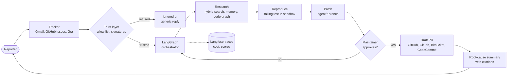

# Issue-to-PR Agent

An open-source agent that turns a trusted bug report into a reviewed draft fix, then sends the reporter a summary of the root cause.

This repository holds the **idea, use cases, plan, and verification approach** only. No implementation exists yet.

## What it does (MVP)

1. A bug report arrives as a **GitHub** issue from an allow-listed author. (Gmail or Jira intake through Langflow is an optional extra in release R5.)
2. A listed maintainer adds the `agent-fix` label.
3. The agent finds the relevant code using memory of past fixes, a code graph, and search.
4. It reproduces the bug with a failing test in a sandbox.
5. It patches the code on an `agent/*` branch and runs the tests.
6. It opens a **draft pull request**. A maintainer reviews and merges.
7. It sends a **root-cause summary**, with citations, to the reporter and the issue, once a maintainer approves it.

The agent never pushes to the default branch and never merges.

## System at a glance

## Works with your stack

The agent talks to three ports, and each organisation picks its adapters in one `org.yaml`. See [docs/INTEGRATIONS.md](docs/INTEGRATIONS.md).

| Port | Adapters |
|---|---|
| Code host | GitHub (MVP), GitLab, Bitbucket, AWS CodeCommit, Azure DevOps |
| Tracker | GitHub Issues (phase 1), Jira or Gmail via Langflow (R5, optional), Zoho, Asana |
| Chat for approvals | Slack, Zoho Cliq, Microsoft Teams |

## Scope at a glance

| Area | MVP | Future |
|---|---|---|
| Intake channel | GitHub label (phase 1); Langflow intake from Jira or Gmail (R5, optional) | Zoho, Asana |
| Languages | Python | Java, C# (repo profiler already designed) |
| Repository provider | GitHub | GitLab, Bitbucket, AWS CodeCommit, Azure DevOps |
| Model | Azure OpenAI: `gpt-5.4-nano` for routing and extraction, `gpt-5.4` for tests, patches, and summaries, `text-embedding-3-large` for search (user's own key) | Other providers behind the same setting |
| Work type | Bug reports | Feature requests (with spec approval) |
| Evidence in summary | Text with citations | Screenshots, with redaction |
| Setup | Self-hosted, user's own keys | VS Code extension, Marketplace |

## Documentation

| Document | Audience | What it covers |
|---|---|---|
| [docs/PITCH.md](docs/PITCH.md) | Mentor, stakeholders | The problem, the proposal, MVP scope, roadmap, risks, and decisions needed |
| [docs/USE-CASES.md](docs/USE-CASES.md) | Everyone | Who uses the agent, for what, with diagrams |
| [docs/WALKTHROUGH.md](docs/WALKTHROUGH.md) | Anyone new | A worked example, step by step, from report to summary |
| [docs/ARCHITECTURE.md](docs/ARCHITECTURE.md) | Architecture review | Components, protocols, trust model, flows, data, security, deployment |
| [docs/AGENTS-TOOLS-SEARCH.md](docs/AGENTS-TOOLS-SEARCH.md) | Builders, architecture review | Agents, MCP tool catalogue with access matrix, search engine, with diagrams |
| [docs/PLAN.md](docs/PLAN.md) | Builders | Phases, roadmap chart, milestones, cut list, risks, and definition of done |
| [docs/VERIFICATION.md](docs/VERIFICATION.md) | Reviewers | Test layers, metrics, datasets, targets, and security tests |
| [docs/DEMO.md](docs/DEMO.md) | Demo owner, reviewers | Demo scenes with expected results, and rehearsal rules |
| [docs/TECHNOLOGY.md](docs/TECHNOLOGY.md) | Builders, mentor | Every technology by layer, why it was chosen, SLOs, and the NIIT rubric mapping |
| [docs/REPO-MEMORY.md](docs/REPO-MEMORY.md) | Builders, architecture review | LlamaIndex memory for many repositories in Python, Java, and C#: the repo profiler, merge and manual refresh, incremental updates |
| [docs/AZURE-SETUP.md](docs/AZURE-SETUP.md) | Owner, builders | Model deployments, which node uses which model, configuration, quota, cost control, and the demo-day checklist |
| [docs/INTEGRATIONS.md](docs/INTEGRATIONS.md) | Builders, architecture review | How the agent plugs into any organisation: code host, tracker, and chat adapters, config, and contract tests |
| [docs/BOUNDARIES.md](docs/BOUNDARIES.md) | Maintainers, reviewers | What the agent may and must never do, and why |
| [docs/FUTURE-SCOPE.md](docs/FUTURE-SCOPE.md) | Everyone | Pending items, grouped by theme, with their dependencies |
| [docs/OPEN-ITEMS.md](docs/OPEN-ITEMS.md) | Owner, collaborators | Unresolved decisions and external dependencies |

## Principles

1. **Trust is an allow-list, not a judgement.** Only listed senders and authors can start the agent.
2. **The agent proposes, a human decides.** Draft changes only. Merging, closing, and labelling stay with maintainers.
3. **Every claim has a source.** Root-cause summaries cite a file, line, commit, or test. Uncited claims are removed.
4. **Keys stay with the user.** Credentials live in the user's own deployment, never in a central service.

## Technology

| Technology | Used for |
|---|---|
| **Gmail API** | Reading labelled reports; sending replies and summaries |
| **GitHub API and webhooks** | Triggers, branches, draft PRs, comments |
| **Azure OpenAI** | The model behind extraction, test writing, patching, and summaries |
| **LangGraph** | Orchestration with checkpointed state |
| **A2A** | Communication between specialist agents |
| **MCP** | Governed tool access: email, repository, docs, code, sandbox, memory, approvals |
| **LlamaIndex** | Retrieval over code, docs, and past fixes |
| **LlamaIndex memory collections** | Persistent memory of past fixes and conventions, refreshed on merge (see [REPO-MEMORY.md](docs/REPO-MEMORY.md)) |
| **Graphify** | Code graph of the repository |
| **gRPC** | Streaming sandbox results to the orchestrator |
| **OpenTelemetry and Langfuse** | Traces, model-call records, cost |

## Licence

MIT. See [LICENSE](LICENSE).
