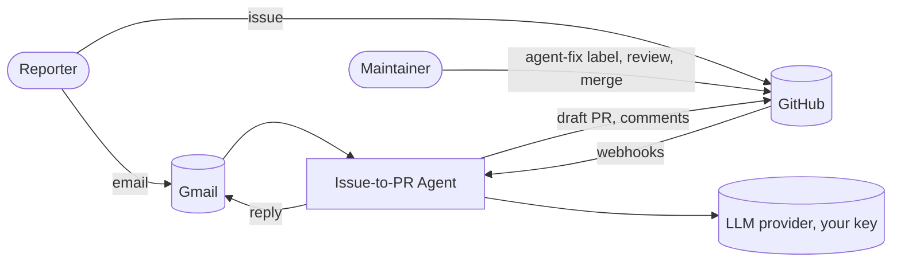

# Issue-to-PR Agent

[](LICENSE)
[](docs/ROADMAP.md)

An open-source agent that turns a trusted bug report into a reviewed draft fix, then explains the root cause back to the reporter.

A report arrives by email. Only allow-listed senders can start the agent. A maintainer adds an `agent-fix` label on GitHub. The agent finds the relevant code using a memory of past fixes and a code graph, reproduces the bug in a sandbox, patches it on a branch, runs the tests, and opens a draft pull request. A maintainer reviews and merges. The agent never pushes to the default branch.

## Status and scope

| Area | Phase 1 (current) | Future |
|---|---|---|
| Intake channel | Gmail | Jira, Zoho |
| Repository provider | GitHub | GitLab, Bitbucket, AWS CodeCommit, Azure DevOps |
| API keys | Each user supplies their own | Same |

**Built so far:** the trust layer and the GitHub webhook receiver. Signature verification, the allow-list, sender authentication for email, the reply rate limit, idempotency, and the audit log are implemented and tested (43 tests).

**Not built yet:** the Gmail connector, the memory and code graph, the reproduction and patch agents, the sandbox, and write-back. These follow the roadmap in [docs/ROADMAP.md](docs/ROADMAP.md).

The design is in [docs/ARCHITECTURE.md](docs/ARCHITECTURE.md).

## Quick start

Requires Python 3.11 or newer.

```bash
python -m venv .venv
. .venv/bin/activate            # Windows: .venv\Scripts\activate
pip install -e ".[dev]"
pytest
```

To run the webhook receiver:

```bash
cp config/allowlist.example.json config/allowlist.json   # then edit it
export GITHUB_WEBHOOK_SECRET="a-long-random-string"
uvicorn issue_to_pr.app:create_app_from_env --factory --port 8000
```

Point a GitHub repository webhook at `https://<your-host>/webhooks/github`, with content type `application/json` and the same secret. Use a tunnel such as `ngrok` for local development.

## Forks

Forks are welcome. Fork the repository, add your own allow-list and keys, and run it against your own repositories. Your keys stay with your deployment and are never sent to this project.

## System context



Jira and Zoho intake, and GitLab, Bitbucket, AWS CodeCommit, and Azure DevOps providers, are shown in the architecture document as future work.

## Principles

1. **Trust is an allow-list, not a judgement.** Only listed senders can start the agent.
2. **The agent proposes, a human decides.** Draft changes only. Merging, closing, and labelling stay with maintainers.
3. **Every claim has a source.** Root-cause summaries cite a file, line, commit, or test. Uncited claims are removed.
4. **Keys stay with the user.** Credentials live on the user's machine or server, never in a central service.

## Documentation

| Document | Audience | What it covers |
|---|---|---|
| [docs/PITCH.md](docs/PITCH.md) | Mentor, stakeholders | The problem, the proposal, scope, risks, and decisions |
| [docs/ARCHITECTURE.md](docs/ARCHITECTURE.md) | Architecture review | Components, protocols, trust model, flows, data, security, deployment, decisions |
| [docs/EVALUATION.md](docs/EVALUATION.md) | Engineering, reviewers | Metrics, datasets, targets, security tests, and how results are reported |
| [docs/ROADMAP.md](docs/ROADMAP.md) | Everyone | Phases, cut list, risks, and definition of done |

## Technology

| Technology | Used for | Phase |
|---|---|---|
| **FastAPI** | Webhook receiver | 1 (built) |
| **Gmail API** | Email intake and replies | 1 |
| **A2A** | Communication between specialist agents | 2 |
| **MCP** | Governed tool access: repository, docs search, sandbox | 2 |
| **LangGraph** | Orchestration with checkpointed state | 2 |
| **LlamaIndex** | Retrieval over code and docs | 2 |
| **Mem0** (or Graphiti) | Persistent memory of past fixes and conventions | 2 |
| **Graphify** | Code graph of the repository | 2 |
| **gRPC** | Streaming sandbox results to the orchestrator | 2 |
| **Langflow** | Intake flows and advocate-editable rules | Later |

## Licence

MIT. See [LICENSE](LICENSE).
