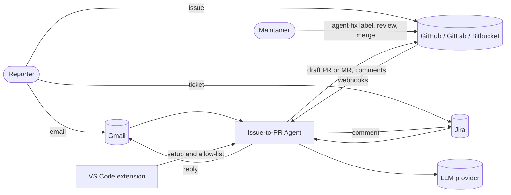

# Issue-to-PR Agent

An open-source agent that turns a trusted bug report into a reviewed draft fix, then explains the root cause back to the reporter.

A report arrives by email, Jira, GitHub, GitLab, or Bitbucket. Only allow-listed senders can start the agent. A maintainer adds an `agent-fix` label. The agent finds the relevant code using a memory of past fixes and a code graph, reproduces the bug in a sandbox, patches it on a branch, runs the tests, and opens a draft pull request or merge request. A maintainer reviews and merges. The agent never pushes to the default branch.

## Status

Design complete for version 1. No implementation yet. The design is in [docs/ARCHITECTURE.md](docs/ARCHITECTURE.md), and the build plan is in [docs/ROADMAP.md](docs/ROADMAP.md).

## System context

## Principles

1. **Trust is an allow-list, not a judgement.** Only listed senders can start the agent.
2. **The agent proposes, a human decides.** Draft changes only. Merging, closing, and labelling stay with maintainers.
3. **Every claim has a source.** Root-cause summaries cite a file, line, commit, or test. Uncited claims are removed.
4. **Keys stay with the user.** Credentials live on the user's machine or server, never in a central service.

## Documentation

| Document | Audience | What it covers |
|---|---|---|
| [docs/PITCH.md](docs/PITCH.md) | Mentor, stakeholders | The problem, the proposal, scope, risks, and decisions needed |
| [docs/ARCHITECTURE.md](docs/ARCHITECTURE.md) | Architecture review | Components, protocols, trust model, flows, data, security, deployment, decisions |
| [docs/EVALUATION.md](docs/EVALUATION.md) | Engineering, reviewers | Metrics, datasets, targets, security tests, and how results are reported |
| [docs/ROADMAP.md](docs/ROADMAP.md) | Everyone | Milestones, risks, definition of done, and open questions |

## Protocols and technology

| Technology | Used for |
|---|---|
| **A2A** | Communication between the specialist agents |
| **MCP** | Governed tool access: repository, docs search, sandbox |
| **LangGraph** | Orchestration with checkpointed state |
| **LlamaIndex** | Retrieval over code and docs |
| **Mem0** (or Graphiti) | Persistent memory of past fixes and conventions |
| **Graphify** | Code graph of the repository |
| **Langflow** | Email and Jira intake flows, and advocate-editable rules |
| **gRPC** | Streaming sandbox results to the orchestrator |
| **SMTP / Gmail API** | Replies to reporters |

## Licence

MIT. See [LICENSE](LICENSE).
