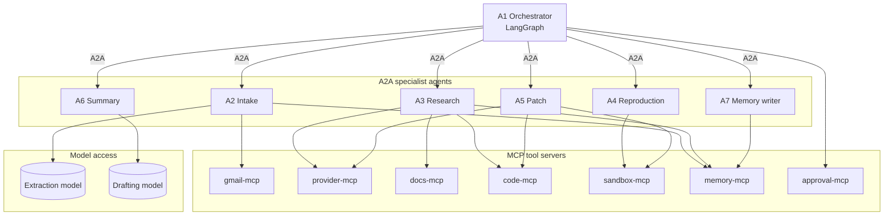
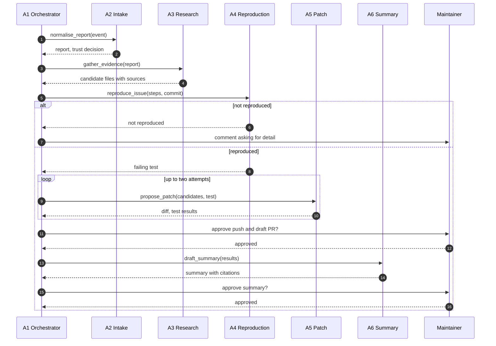
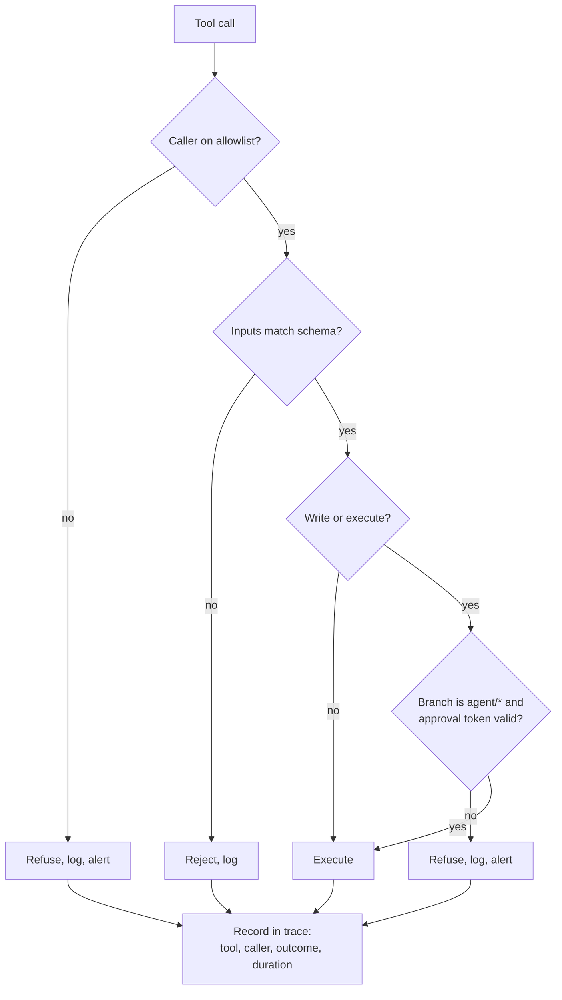
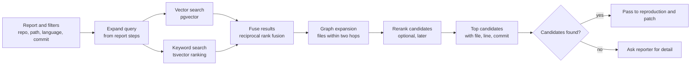

# Agents, MCP Tools, and Search

**Audience:** builders and the architecture review. **Status:** planned, not started.

This document lists the agents, the MCP tools they can call, and the search engine behind retrieval. It is the detailed companion to [ARCHITECTURE.md](ARCHITECTURE.md).

## 1. Design rules

1. **Agents own reasoning steps. Tools own data and side effects.** No agent writes to GitHub, Gmail, or the memory store directly.
2. **Deterministic first.** Trust decisions, label checks, and branch rules are code. Models are used only for extraction and for drafting text that a human approves.
3. **Least privilege.** Each agent has an explicit allowlist of tools. Writes need an approval token.
4. **Every call is traced.** One trace per issue, covering agent steps, tool calls, and model calls.
5. **Untrusted text is data.** Issue bodies and email content never change the plan, the tools, or the budgets.

## 2. Agents

Agents are A2A services. The orchestrator is a LangGraph graph inside its own process.

| # | Agent | Type | Job | Model use | Key outputs | Failure states |
|---|---|---|---|---|---|---|
| A1 | Orchestrator | LangGraph graph | Runs the workflow, checkpoints each step, enforces budgets, requests approvals | None | Run state, outcome | Step failure, budget exhausted |
| A2 | Intake | A2A service | Normalises email and GitHub events; applies trust checks; extracts title, steps, expected, and actual | Field extraction from the message body only | Normalised report, trust decision | Unauthenticated, not allow-listed, missing fields |
| A3 | Research | A2A service | Gathers evidence: memory, code-graph neighbours, retrieval over code, docs, and past fixes | Optional: query rewriting | Ranked candidate files with sources | No candidates found |
| A4 | Reproduction | A2A service | Writes a failing test and runs it in the sandbox | Test writing | Reproduced, not reproduced, or could not run; logs | Not reproduced, sandbox timeout |
| A5 | Patch | A2A service | Edits the working copy, runs the full suite, retries once | Code editing | Diff, test results | Tests still failing after two attempts |
| A6 | Summary | A2A service | Writes the five-part root-cause summary with citations | Drafting only | Summary with citation IDs | Uncited claim removed; summary rejected |
| A7 | Memory writer | A2A service | Writes `bug_fix` and `root_cause` records after a merge | None | Memory records with provenance | Source commit not found |

Approvals are handled by an approval service with its own tool (`approval-mcp`). It isn't an agent, so no model can approve its own work.

### Agent cards (summary)

| Agent | Skills | Input and output modes |
|---|---|---|
| Intake | `normalise_report` | application/json |
| Research | `gather_evidence` | application/json |
| Reproduction | `reproduce_issue` | application/json |
| Patch | `propose_patch` | application/json |
| Summary | `draft_summary` | application/json |
| Memory writer | `write_memory` | application/json |

A2A task states: `submitted`, `working`, `input-required`, `completed`, `failed`. The reproduction agent uses `input-required` when it needs the reporter's detail. The orchestrator relays that request as a comment.

### Budgets

| Limit | Value |
|---|---|
| Patch attempts per issue | 2 |
| Reproduction time | Sandbox limit, set in the deployment |
| Model calls per issue | Set per deployment from the cost cap |
| Triage time before escalation | Set per deployment |

## 3. Agent topology

## 4. Fix sequence

## 5. MCP tool servers

| Server | Purpose | Owner reason to change |
|---|---|---|
| gmail-mcp | Read labelled messages and their authentication results; send replies | Email provider changes |
| provider-mcp | Issues, branches, comments, and review requests on GitHub (later GitLab and others) | Provider API changes |
| docs-mcp | Search and read documentation sections | Docs layout changes |
| code-mcp | Search code, read symbols and line ranges, and walk the code graph | Graph or index changes |
| sandbox-mcp | Run tests in the isolated sandbox and read the logs | Sandbox runtime changes |
| memory-mcp | Read and write memory records, with provenance | Memory store changes |
| approval-mcp | Request, check, and record approvals | Approval process changes |

### Tool catalogue

| Tool | Server | Access | Inputs | Output | Approval | Callers |
|---|---|---|---|---|---|---|
| `gmail.read_labelled` | gmail-mcp | Read | Label, page token | Messages with headers and auth results | None | A2 |
| `gmail.send_reply` | gmail-mcp | Write | Thread ID, body | Message ID | Approval for the first ten; rate limit after | Orchestrator |
| `provider.get_issue` | provider-mcp | Read | Issue number | Title, body, labels, author | None | A2, A3 |
| `provider.search_issues` | provider-mcp | Read | Query, state | Matching issues | None; rate-limited | A3 |
| `provider.comment` | provider-mcp | Write | Issue number, body | Comment URL | Approval token | Orchestrator |
| `provider.push_branch` | provider-mcp | Write | Branch name (`agent/*` only), commit | Branch reference | Approval token | Orchestrator |
| `provider.open_draft_review` | provider-mcp | Write | Branch, title, body | Draft PR or MR URL | Approval token | Orchestrator |
| `docs.search` | docs-mcp | Read | Query, top k | Chunks with source paths | None | A3 |
| `code.search` | code-mcp | Read | Query, path filter, top k | Chunks with file and line | None | A3, A5 |
| `code.graph_neighbours` | code-mcp | Read | File path, hops | Neighbouring files | None | A3 |
| `code.read_lines` | code-mcp | Read | File, start, end | Lines | None | A3, A5 |
| `sandbox.run_tests` | sandbox-mcp | Execute | Commit SHA, test filter, timeout | Pass or fail; log reference | None; sandbox only | A4, A5 |
| `memory.lookup` | memory-mcp | Read | Query, repo | Records with provenance | None | A2, A3 |
| `memory.write` | memory-mcp | Write | Record, provenance | Record ID | Approval (merged change) | A7 |
| `approval.request` | approval-mcp | Write | Action, payload | Request ID | None (creates the request) | Orchestrator |
| `approval.decision` | approval-mcp | Read | Request ID | Pending, approved, or rejected | None | Orchestrator |
| `approval.record` | approval-mcp | Write | Request ID, decision, approver | Record | Maintainer identity check | Review UI |

### Access matrix

An `x` means the agent may call the tool. Anything else is refused and logged.

| Tool | A2 Intake | A3 Research | A4 Reproduction | A5 Patch | A6 Summary | A7 Memory writer |
|---|---|---|---|---|---|---|
| `gmail.read_labelled` | x | | | | | |
| `gmail.send_reply` | | | | | | |
| `provider.get_issue` | x | x | | | | |
| `provider.search_issues` | | x | | | | |
| `provider.comment` | | | | | | |
| `provider.push_branch` | | | | | | |
| `provider.open_draft_review` | | | | | | |
| `docs.search` | | x | | | | |
| `code.search` | | x | | x | | |
| `code.graph_neighbours` | | x | | | | |
| `code.read_lines` | | x | | x | | |
| `sandbox.run_tests` | | | x | x | | |
| `memory.lookup` | x | x | | | | |
| `memory.write` | | | | | | x |
| `approval.request` | | | | | | |
| `approval.decision` | | | | | | |
| `approval.record` | | | | | | |

Rows with no agent access are called by the orchestrator, the intake service, or the review interface. They are listed so the matrix is complete.

### Controls on every tool call

Two rules never change: the agent pushes only to `agent/*` branches, and no tool can merge, close, or change branch protection.

## 6. Search engine

### Recommendation

**PostgreSQL with pgvector and full-text search**, in the same database as the run records. It's simple to run, the filters are plain SQL, and no second system needs to be kept in sync.

| Option | Strength | Cost | Use when |
|---|---|---|---|
| PostgreSQL + pgvector + tsvector (recommended) | One store; SQL filters | Vector search is slower at very large scale | The MVP: one repository's code, docs, and issues |
| OpenSearch | Strong keyword and vector search | A second system to run | A large monorepo or many repositories |

### Pipeline

### What is indexed

| Index | Contents | Chunking | Filters |
|---|---|---|---|
| Code | Functions and classes, with file, line range, and commit | One chunk per symbol | Repo, path, language, commit |
| Docs | Documentation sections | One chunk per heading section | Repo, path, version |
| Issues | Closed issues and their fixing commits | One chunk per issue, with linked commit | Repo, state, labels |

The memory store (Mem0 or Graphiti) is separate from the search index. Memory holds decisions and provenance; search holds the code and text they refer to.

### Retrieval rules

- Results carry the file, line range, and commit they came from. Every citation in a summary must resolve to one of these.
- The index is rebuilt for each merged change in the indexed paths, and each entry records the commit it reflects.
- Empty results lead to a question to the reporter, not a guess.
- The embedding model is chosen in Phase 0. Its name and version are recorded with the index, and changing it requires re-indexing and re-running the verification set.

### Search measures

| Measure | Definition | Target |
|---|---|---|
| Recall at five | Share of reproduced bugs whose fixing file is in the top five candidates | At least 70% |
| Stale results | Results pointing to a commit older than the indexed head | 0 |
| Citation resolution | Summary citations that resolve to an indexed file, line range, and commit | 100% |

The query set comes from the seeded bugs: each bug's report is a query, and its fixing file is the expected result.

## 7. Diagram key

- Solid arrows: direct calls.
- Dashed or labelled arrows: fallback use or a relay.
- Subgraphs: groups that share a process, a server, or an owner.

## 8. Build order

1. `provider-mcp` and `sandbox-mcp`, since reproduction depends on them.
2. Intake agent with trust checks and the Gmail tool.
3. Search index and `code-mcp`, with the seeded-bug query set.
4. Research, reproduction, and patch agents.
5. Summary and memory writer, then the access matrix tests.

## 9. External MCP servers

These are third-party or vendor servers that the build may use. Each one sits behind the approval layer; none is exposed to an agent directly.

| Server | Publisher | Use in this build | Status |
|---|---|---|---|
| GitHub MCP server | GitHub (official) | Base for the read tools in `provider-mcp`, which reduces build work | Repository URL, licence, and permission scopes to confirm |
| Playwright MCP | Microsoft | Reproducing web-related bugs, inside the sandbox only | Publisher confirmed; sandbox use only |
| Context7 | Upstash (to confirm) | Current library documentation for the patch agent | Publisher and licence to confirm |
| Git reference server | Model Context Protocol project | Branch and commit operations inside the worktree | Not verified; confirm before use |

Rules for external servers:
- Wrap every external server behind the approval gate. Write tools are never exposed to an agent directly.
- Don't use the memory reference server. Memory is Mem0, with provenance and staleness checks, which the reference server doesn't provide.
- Pin each server to a version and record it in the audit log.
