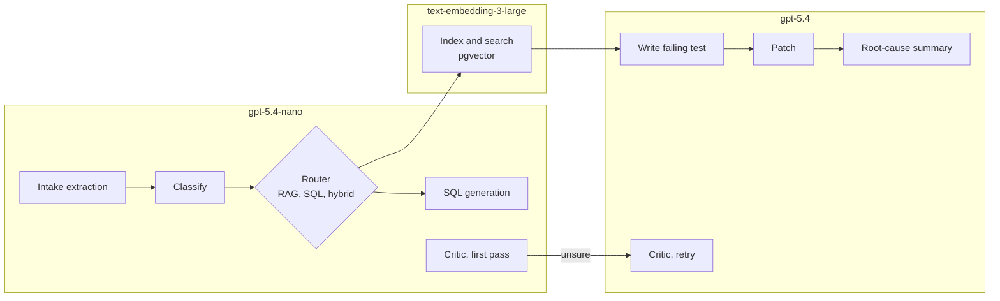

# Azure OpenAI setup

**Audience:** the project owner and anyone running a fork. **Status:** deployments created 28 Oct 2026 on the owner's personal subscription; cost and latency baselines not yet measured.

The agent uses three Azure OpenAI deployments in one resource. The cheap model handles most calls, and the strong model is used only where code is written or a reporter will read the result. This split is also the cost story for the SLO report.

## Deployments

| Role | Model | Used by | Why this model |
|---|---|---|---|
| Embeddings | `text-embedding-3-large` | Indexing and search over code, docs, and past fixes | Strongest OpenAI embedding model on Azure; can return shortened vectors (see pgvector below) |
| Small model | `gpt-5.4-nano` | Intake extraction, trust explanation, classification, query routing (RAG, SQL, or hybrid), SQL generation, critic first pass | Cheap and fast for short structured outputs |
| Strong model | `gpt-5.4` | Failing-test writing, patching, root-cause summary, critic retry when the small model is unsure | Code quality and citations matter here |

Record the model version shown in the Azure portal for each deployment in `config/models.yaml`. Changing a version means re-running the verification set.

### Which graph node calls which model



Escalation rule: a node moves from the small to the strong model only when the small model's output fails validation or its confidence is below the threshold. Each move is logged in Langfuse so the report can show how often it happens.

## Configuration

Settings live in environment variables. Keys never go in the repository.

```dotenv
# .env.example
AZURE_OPENAI_ENDPOINT=https://<your-resource>.openai.azure.com/
AZURE_OPENAI_API_KEY=            # or leave empty and use Entra ID
AZURE_OPENAI_API_VERSION=        # the version your portal shows for these models
AZURE_OPENAI_DEPLOYMENT_SMALL=gpt-5.4-nano
AZURE_OPENAI_DEPLOYMENT_STRONG=gpt-5.4
AZURE_OPENAI_DEPLOYMENT_EMBED=text-embedding-3-large
EMBEDDING_DIMENSIONS=1536       # passed as `dimensions` on every embedding call
MAX_TOKENS_PER_ISSUE=            # set from the week-2 baseline
```

Use the deployment name, not the model name, in every call. If the deployment names in the portal differ from the model names, put the portal names here.

For keys, prefer Microsoft Entra ID (`DefaultAzureCredential`) over an API key. If you use a key, keep it in `.env` locally and in Azure Key Vault or GitHub Actions secrets elsewhere.

### pgvector

`text-embedding-3-large` returns 3072 dimensions by default. pgvector's HNSW and IVFFlat indexes support at most 2,000 dimensions for the `vector` type, so a full-size vector can't be indexed as `vector(3072)`. Two options:

| Option | Column | Trade-off |
|---|---|---|
| **Shortened vectors (recommended)** | `vector(1536)`, with `dimensions=1536` on every call | Indexable, half the storage, small quality loss that the retrieval tests will show |
| Full vectors at half precision | `halfvec(3072)` (indexable up to 4,000 dimensions) | Full quality, more storage, needs a recent pgvector |

Use the same `dimensions` value at indexing and query time. The index records the embedding model, version, and dimensions. Changing any of them means re-indexing everything.

## Things to check in week 1

| # | Check | Why | How |
|---|---|---|---|
| 1 | Smoke test each deployment | Catch wrong endpoints, versions, or names early | One chat call to each model and one embedding call; save the output |
| 2 | Supported parameters | Newer reasoning-style models can reject `temperature` or `max_tokens` and expect `max_completion_tokens` | Send each parameter once; keep only the ones the deployment accepts |
| 3 | Quota (tokens per minute) for each deployment | Rate limits are the most likely way a live demo fails | Read the quota in the portal; request an increase now if a seeded-bug run hits it |
| 4 | Content filters | The injection and security test prompts can trip Azure's filters | Run the red-team set once; record which prompts are blocked and decide whether the block is the right outcome |
| 5 | Shortened embeddings | Confirm `dimensions=1536` works on the deployment and that search quality holds | Embed the retrieval test set at 1536 and, once, at 3072 (`halfvec`); compare recall |
| 6 | Data terms for the resource | Code from the test fork is sent to the model | Read Microsoft's current data, privacy, and abuse-monitoring terms for Azure OpenAI and note them in the data-handling note |

## Cost control

- Set an Azure budget with alerts at 50% and 90% of your monthly limit.
- Cap tokens per issue (`MAX_TOKENS_PER_ISSUE`) and keep the two-attempt limit from [PLAN.md](PLAN.md).
- Langfuse records tokens per call. Add the per-token prices for each deployment from the Azure pricing page so cost per issue is computed, not estimated.
- Measure the baseline on the seeded bugs in week 2, then set the cost SLO from it.

| Measure | Small | Strong | Embeddings | Per issue |
|---|---|---|---|---|
| Calls per issue | to measure | to measure | to measure | — |
| Tokens per issue | to measure | to measure | to measure | to measure |
| Cost per issue | to measure | to measure | to measure | to measure |
| P95 latency per call | to measure | to measure | to measure | — |

## Demo-day checklist

1. Pin prompt versions in Langfuse. Use the lowest-randomness settings the deployments accept.
2. Run all scenes in [DEMO.md](DEMO.md) the day before, on the final build.
3. Warm up each deployment with one call about ten minutes before presenting.
4. Check the remaining quota and budget that morning.
5. Keep a recording of every scene as a backup.
6. Optional: a second resource in another region with the same deployment names, switched by changing `AZURE_OPENAI_ENDPOINT`.
