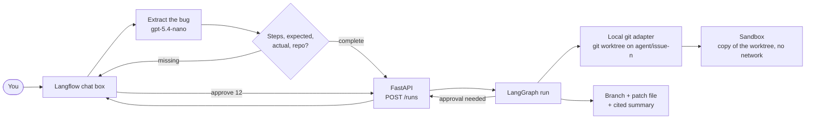

# Chat intake and local repositories

**Audience:** owner and builders. **Status:** decided 28 Oct 2026 for phase 1.

Phase 1 has no Jira. Bugs come in through a **Langflow chat box**, and the code lives in a **git repository on the owner's machine**. Both fit the existing ports in [INTEGRATIONS.md](INTEGRATIONS.md) as two new adapters, so nothing in the agent core changes:

| Port | Phase 1 adapter | Later adapters |
|---|---|---|
| Tracker (where bugs come from) | **Langflow chat** | GitHub Issues, Jira, Gmail, Zoho |
| CodeHost (where code lives) | **Local git** | GitHub, GitLab, Bitbucket, CodeCommit |
| Notifier (where approvals happen) | **Langflow chat** | Slack, Zoho Cliq, Teams |

This is also a good viva point: the same agent ran on chat and a local repository, and swapping to Jira and GitHub is a config change in `org.yaml`.

## How it fits together

## The chat flow in Langflow

1. **Chat Input** takes the message, for example: "In my-api, `GET /orders?date=2024-02-30` returns 500 instead of 400."
2. **Extract** (a prompt on `gpt-5.4-nano` with a JSON output schema): repo, title, steps, expected, actual.
3. **Ask for what's missing.** If a field is empty, the flow replies with one specific question instead of guessing. Langflow's chat memory keeps the conversation together.
4. **Pick the repo.** The flow calls `GET /repos` and matches the name. If it's ambiguous, it lists the options.
5. **Start the run.** An HTTP Request component calls `POST /runs` with the report and returns "Run 12 started" plus a link to its trace.

Chat commands the same flow understands:

| You type | What happens |
|---|---|
| a bug description | Starts a run, after asking for anything missing |
| `status 12` | Calls `GET /runs/12` and shows the current step and confidence |
| `approve 12` / `reject 12 <reason>` | Calls `POST /approvals` for the pending gate |
| `reindex my-api` | Calls `POST /repos/{id}/memory/refresh` |
| `repos` | Lists connected repos with language and indexed commit |
| `add repo C:\code\my-shop` | Onboards a folder: scan, profile, embed, code map, generated docs and scripts. See [REPO-ONBOARDING.md](REPO-ONBOARDING.md) |
| `approve scripts my-shop` | Allows the generated `run-app.bat` and `run-tests.bat` to run |
| `where my-shop "coupon gives 500"` | Ranks the most likely files without starting a fix |

The flow is exported as `langflow/chat-intake.json` and kept in the repo.

## The local git adapter

The agent never edits your working copy directly.

| Step | What the adapter does |
|---|---|
| Connect | You register the folder once: `itp repo add --path C:\code\my-api` (or `POST /repos`). The repo profiler then detects Python. |
| Start a fix | `git worktree add ../.itp-worktrees/issue-12 -b agent/issue-12` from the default branch, so your own checkout and uncommitted work are untouched |
| Test | The sandbox runs on a copy of the worktree with no network and no secrets |
| Patch | Commits on `agent/issue-12` inside the worktree only |
| "Pull request" | After approval: the branch stays in your repo, and a `patches/issue-12.patch` and `issue-12-summary.md` are written for review |
| Merge | You merge the branch yourself (`git merge agent/issue-12`). A `post-merge` git hook, or `reindex my-api` in chat, refreshes the memory |

Rules:
- The agent only writes inside `.itp-worktrees/` and on `agent/*` branches. It never touches the default branch or your working tree.
- Only folders you register are reachable. Paths are checked against the registered root.
- If the API runs in Docker, mount the registered folder into the container; the worktree folder is the only writable mount.
- Use your own or open-source code only, never an employer's repository.

## Trust in chat mode

The allow-list becomes "who can use the chat". Phase 1 has one user: you, signed in to Langflow with an API key, and the FastAPI endpoints require that key. The trust tests still apply to text inside the bug report: instructions in it are treated as data, never followed.

## Optional: show a real draft PR

To show a GitHub draft PR in the demo, push the same repository to a private GitHub repo and switch the CodeHost adapter to GitHub in `org.yaml`. The chat intake stays the same. This can wait until R5.
