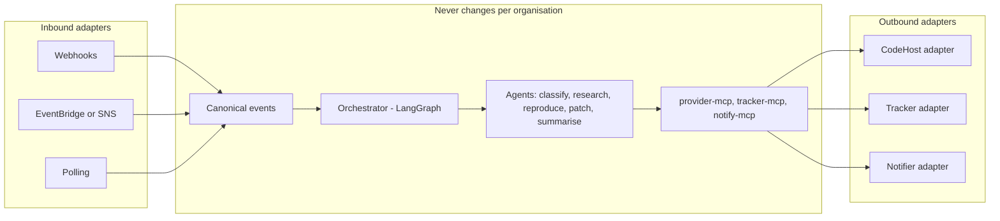

# Integrations

**Audience:** builders and architecture review. **Status:** proposal. Nothing is implemented yet.

This document explains how the agent fits into any organisation's tools without changing the pipeline. Organisations differ: one keeps code in AWS CodeCommit and tickets in Jira, another uses Bitbucket and Jira, a third uses GitHub or GitLab for both. Chat differs too: Slack, Zoho Cliq, or Microsoft Teams.

It expands the "Provider adapters" component in [ARCHITECTURE.md](ARCHITECTURE.md) and the provider rows in [FUTURE-SCOPE.md](FUTURE-SCOPE.md).

Contents:
1. [Three ports](#three-ports)
2. [What changes per organisation](#what-changes-per-organisation)
3. [Canonical models](#canonical-models)
4. [Port interfaces](#port-interfaces)
5. [Organisation config](#organisation-config)
6. [Provider differences](#provider-differences)
7. [Safety stays in one place](#safety-stays-in-one-place)
8. [Vendor MCP servers](#vendor-mcp-servers)
9. [Contract tests](#contract-tests)
10. [Build order](#build-order)

## Three ports

The agent never calls a vendor API directly. It talks to three ports, and each deployment chooses an adapter for each one.

| Port | What it does for the agent | Adapters |
|---|---|---|
| **CodeHost** | Clone, push an `agent/*` branch, open a draft change request, comment on it, receive merge and close events | Local git (phase 1, see [CHAT-AND-LOCAL-MODE.md](CHAT-AND-LOCAL-MODE.md)), GitHub, GitLab, Bitbucket, AWS CodeCommit, Azure DevOps |
| **Tracker** | Receive "fix requested" events, read the issue, post the root-cause summary | Langflow chat (phase 1), GitHub Issues, GitLab Issues, Jira, Zoho (Desk, Projects, or BugTracker), Asana, Azure Boards |
| **Notifier** | Ask an approver for a decision, send status updates, receive approve and reject actions | Langflow chat (phase 1), Slack, Zoho Cliq, Microsoft Teams, email |

CodeHost and Tracker are separate ports on purpose. AWS CodeCommit has no issue tracker of its own, so a CodeCommit organisation always takes issues from somewhere else, usually Jira. A design that assumes "GitHub issue plus GitHub pull request" fails there on day one.

Asana is a tracker, not a chat tool. It sits beside Jira and Zoho. Zoho Cliq sits beside Slack.

Gmail intake from the MVP becomes one more Tracker adapter: an allow-listed email creates the issue, and the reply goes back to the same thread.

## What changes per organisation



Agents, prompts, retrieval, memory, evaluation, and traces are the same in every deployment. Only the adapters at the edges change.

## Canonical models

The adapters translate vendor payloads into these models and back. Nothing past the adapter sees a vendor payload.

```python
class Principal(BaseModel):
    source: str              # "jira", "github", "slack", ...
    id: str                  # account ID, login, or member ID
    display_name: str

class IssueRef(BaseModel):
    tracker: str             # "jira"
    key: str                 # "PAY-142"

class Issue(BaseModel):
    ref: IssueRef
    title: str
    body: str
    author: Principal        # checked against the allow-list
    labels: list[str]
    repo: RepoRef | None     # resolved through repo_mapping when the tracker has no repo

class ChangeRequest(BaseModel):
    # A pull request on GitHub, Bitbucket, CodeCommit, and Azure DevOps;
    # a merge request on GitLab.
    repo: RepoRef
    source_branch: str       # must match "agent/*"
    target_branch: str
    title: str
    body: str
    draft: bool = True

class AgentEvent(BaseModel):
    kind: Literal["fix_requested", "approval_given", "approval_rejected",
                  "change_merged", "change_closed", "comment_added"]
    source: str
    delivery_id: str         # idempotency key
    actor: Principal
    payload: Issue | ChangeRequest | Approval
```

## Port interfaces

```python
class CodeHost(Protocol):
    capabilities: set[Capability]     # DRAFT, LABELS, SIGNED_WEBHOOKS, ...
    def clone_url(self, repo: RepoRef) -> str: ...
    def push_branch(self, repo: RepoRef, branch: str, commit: str, token: ApprovalToken) -> str: ...
    def open_change_request(self, cr: ChangeRequest, token: ApprovalToken) -> str: ...
    def comment_on_change(self, ref: ChangeRef, body: str, token: ApprovalToken) -> str: ...
    def parse_event(self, headers: dict, body: bytes) -> AgentEvent | None: ...   # verifies the signature

class Tracker(Protocol):
    def get_issue(self, ref: IssueRef) -> Issue: ...
    def post_comment(self, ref: IssueRef, body: str, token: ApprovalToken) -> str: ...
    def parse_event(self, headers: dict, body: bytes) -> AgentEvent | None: ...

class Notifier(Protocol):
    def request_approval(self, req: ApprovalRequest) -> str: ...   # buttons or a card
    def send(self, channel: str, message: str) -> None: ...
    def parse_event(self, headers: dict, body: bytes) -> AgentEvent | None: ...
```

`capabilities` lets the pipeline adapt without vendor checks in agent code. For example, where a host has no native draft, the adapter marks the change request as a draft through its title and requests no reviewers.

## Organisation config

One file per deployment chooses the adapters. Switching organisations is a change to this file, not to code.

```yaml
# org.yaml: CodeCommit for code, Jira for tickets, Slack for approvals
code_host:
  type: codecommit
  region: ap-south-1
  repos: [payments-service]
  events: eventbridge              # CodeCommit has no webhooks
tracker:
  type: jira
  base_url: https://example.atlassian.net
  project: PAY
  trigger_label: agent-fix
  allow_list: [jira-account-id-1, jira-account-id-2]
  repo_mapping: { PAY: payments-service }
notifier:
  type: slack                      # or: cliq, teams, email
  approval_channel: "#agent-approvals"
  approvers: [U0123, U0456]
secrets: env                       # keys stay in the deployment
```

The same deployment on Bitbucket changes two lines: `code_host.type: bitbucket` and its workspace and repository names.

## Provider differences

The adapters absorb these differences. Confirm each against current vendor documentation when the adapter is built.

| Area | GitHub | GitLab | Bitbucket | CodeCommit | Azure DevOps |
|---|---|---|---|---|---|
| Name of a change | Pull request | Merge request | Pull request | Pull request | Pull request |
| Draft | Native | Native (draft flag) | No native draft: title prefix, no reviewers | No native draft: title prefix, no approval rule | Native |
| Events in | Signed webhooks | Webhooks with a secret token | Webhooks; confirm the signing method | EventBridge or SNS | Service hooks |
| Own issue tracker | Yes | Yes | Yes, often replaced by Jira | No | Yes (Boards) |
| Python client | REST or PyGithub | python-gitlab | REST | boto3 | azure-devops |

| Tracker or chat | Events in | Notes |
|---|---|---|
| Jira | Webhooks; REST out | Allow-list by account ID; comments only, no status changes |
| Zoho Desk, Projects, BugTracker | Webhooks; REST with OAuth | Each product has its own API; pick one per deployment |
| Asana | Webhooks with a handshake; REST out | Tasks, not issues; a tag stands in for `agent-fix` |
| Slack | Events API and interactive buttons | Buttons call back into the approval service |
| Zoho Cliq | Bot and message actions | Same approval flow through a Cliq bot |
| Microsoft Teams | Bot Framework and Adaptive Cards | Later, when a deployment needs it |

Git itself is standard. Clone, branch, commit, and push work the same over HTTPS or SSH on every host. Only the API calls need an adapter.

## Safety stays in one place

The approval token is checked inside the MCP server, before any adapter is called. A new adapter cannot bypass the rules in [BOUNDARIES.md](BOUNDARIES.md): draft changes only, `agent/*` branches only, and a human approves every write. The audit log is written at the same point, so every adapter is audited the same way.

The allow-list is checked on the canonical `Principal`, so the same rule applies to a Jira account ID, a GitHub login, and an email sender.

## Vendor MCP servers

Vendors publish MCP servers, for example for GitHub, Atlassian, GitLab, and Slack. They can serve **read** tools where they save work. **Write** tools stay in this project's own `provider-mcp`, `tracker-mcp`, and `notify-mcp`, because that is where the approval token, branch rules, and audit log live. A vendor server does not know those rules. See open item 17 in [OPEN-ITEMS.md](OPEN-ITEMS.md).

## Contract tests

Every adapter must pass one shared contract suite, run with pytest:
- recorded webhook and event payloads for each vendor, including forged signatures and replays
- recorded API responses for each call in the port interface
- the same expected canonical output for equivalent inputs across vendors
- refusal of any write without a valid approval token

A fake adapter for each port passes the same suite, so the pipeline's tests never call a vendor.

Adding a provider means writing an adapter, passing the contract suite, and adding a section to `org.yaml`.

## Build order

| Order | Adapter | Reason |
|---|---|---|
| 1 | Local git (CodeHost) and Langflow chat (Tracker, Notifier) | Phase 1: no Jira needed; works on the owner's local repository |
| 2 | GitHub (CodeHost and Tracker) | Draft PRs in the demo; the most common host |
| 2b | Gmail (Tracker) | Optional |
| 3 | Jira (Tracker) | The most common second channel, and the proof that CodeHost and Tracker are separate |
| 4 | Slack (Notifier) | A visible approval step, if open item 1 chooses chat for approvals |
| 5 | AWS CodeCommit (CodeHost) | Pairs with Jira; different event model |
| 6 | Bitbucket (CodeHost) | Common with Jira |
| 7 | GitLab, Zoho, Zoho Cliq, Asana, Azure DevOps, Teams | As deployments ask for them |

Items 1 and 2 are the MVP. Items 3 and 4 are the first candidates if the MVP scope changes; see open items 22 and 23 in [OPEN-ITEMS.md](OPEN-ITEMS.md).
