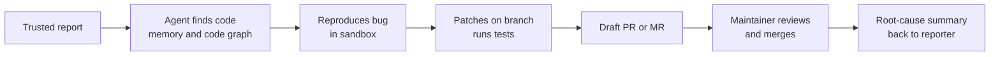

# Pitch: Issue-to-PR Agent

**Audience:** mentor and stakeholders. **Reading time:** five minutes.

## The problem

Bug reports arrive by email, Jira, and repository issues. Someone reads each report, finds the code, writes a fix, opens a pull request, and later explains the root cause to the reporter. The steps are repeated for every bug, and the reasoning behind the fix is rarely recorded.

## The proposal

An agent that turns a trusted bug report into a reviewed draft fix and explains the root cause when it is done.

## Who can start it

Trust is set by an allow-list per project, not by who can see the repository.

- **Email:** allow-listed addresses, verified with the sender's authentication results. Anyone else gets one generic reply per day: "You are not permitted to raise issues through this channel."
- **Repository issues (GitHub, GitLab, Bitbucket):** only allow-listed accounts start the agent. Other people can still file issues, but the agent ignores them.
- **Jira:** allow-listed account IDs.

A maintainer must also add the `agent-fix` label before any work starts.

## Why it's worth building

- **Measurable.** Each stage has a metric: time to draft, acceptance rate, root-cause accuracy, and memory hit rate.
- **Improves with use.** Memory of past fixes means a second fix in the same module should be faster. This is measurable.
- **Current standards.** It uses MCP for tools, A2A between agents, and gRPC for the sandbox.
- **Open source with a setup tool.** Users run it with their own keys, and a VS Code extension guides the setup.

## Scope for version 1

In:
- One reference repository the team controls
- GitHub webhooks first
- Gmail or Jira intake, one of the two
- Allow-list on every channel
- Draft PRs only, with a human merge
- Root-cause summary to the source
- Self-hosting guide and extension setup

Out:
- Automatic merge, close, or label changes
- Email to people outside the team without approval
- Central hosting of users' keys or repositories
- GitLab and Bitbucket adapters until the GitHub path works (listed as stretch)

## Main risks

| Risk | Response |
|---|---|
| Random users trigger the agent | Allow-list on every channel; no work starts without it |
| Spoofed email sender | Authentication results checked, not just the From address |
| Malicious code in a patch | Human review, no auto-merge, CI for agent PRs runs without secrets |
| Malicious text in a report | Report text is data; tools limited to an allow-list |
| Source code sent to an external LLM | Configurable model provider; a self-hosted option is a decision for the architecture review |
| Wrong root cause | Summaries cite evidence; maintainer approves before posting |
| Cost overrun | Per-issue budget enforced by the orchestrator |

Full analysis: [ARCHITECTURE.md](ARCHITECTURE.md#security-and-threat-model).

## Milestones

| Weeks | Milestone |
|---|---|
| 1 | Reference repository chosen; code graph built; memory schema agreed |
| 2–3 | GitHub path: allow-listed issue to draft PR on seeded bugs |
| 4 | Email or Jira intake with allow-list and generic reply |
| 5 | Root-cause write-back with approval |
| 6 | Extension setup flow and self-hosting guide |
| 7 | Evaluation, demo, and a short write-up |

Seven weeks is tight for this scope. The roadmap lists what gets cut first if the schedule slips.

## Decisions needed

1. Approve the reference repository. Criteria: a repository the team controls, a test suite under ten minutes, and clear contribution rules.
2. Choose the intake channel for version 1: Gmail or Jira.
3. Approve the model-provider policy: whether source code may be sent to an external LLM provider, or a self-hosted model is required.
4. Confirm that the first ten replies to reporters need approval.
5. Confirm the licence (proposed: MIT) and whether the extension is published on the VS Code Marketplace.

## What success looks like

By week 7: an allow-listed report becomes a GitHub issue and a draft PR; a non-allow-listed report is ignored or gets the generic reply; a root-cause summary is posted back to the source; a new user completes setup from the guide; and the evaluation table reports time, acceptance rate, root-cause accuracy, and memory hit rate.
