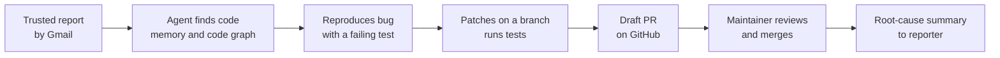
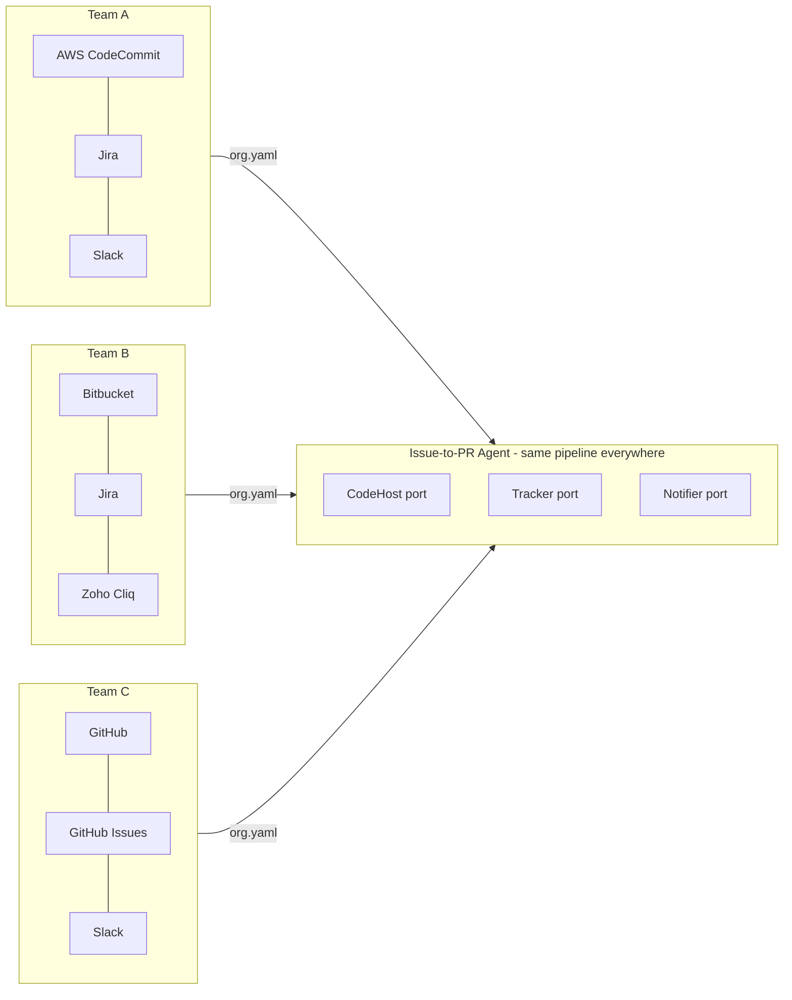
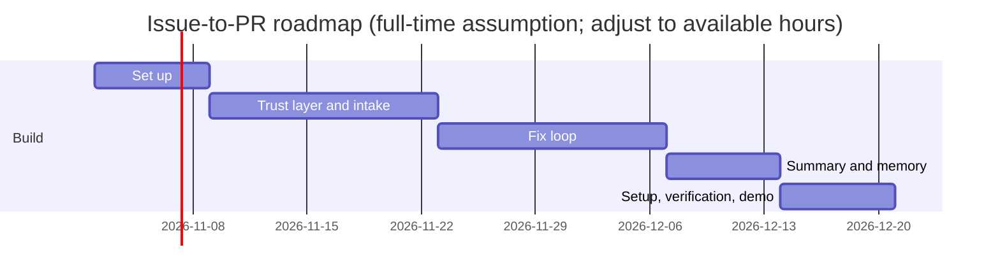

# Pitch: Issue-to-PR Agent

**Audience:** mentor and stakeholders. **Reading time:** five minutes. **Status:** proposal; nothing is built yet.

## The problem

Bug reports arrive by email and repository issues. Someone reads each report, finds the code, writes a fix, opens a pull request, and later explains the root cause to the reporter. The steps repeat for every bug, and the reasoning behind a fix is rarely recorded.

## The proposal

An agent that turns a trusted bug report into a reviewed draft fix, and then tells the reporter what went wrong and why.

A step-by-step example is in [WALKTHROUGH.md](WALKTHROUGH.md).

## Who can start it

Trust is an allow-list, not a judgement about the person.

- **Email:** only allow-listed addresses. The mail must pass SPF and DKIM checks for the sender's domain. Unauthenticated mail is dropped with no reply. An authenticated stranger gets one generic reply per day: "You are not permitted to raise issues through this channel."
- **GitHub issues:** only allow-listed authors can start the agent, and a listed maintainer must add the `agent-fix` label. Anyone else can still file an issue; the agent ignores it.

## Works with any team's stack

Teams keep code and tickets in different places. The agent never calls a vendor directly: it uses three ports, and each organisation chooses its adapters. Details are in [INTEGRATIONS.md](INTEGRATIONS.md).

Most coding agents assume GitHub. Many enterprise teams don't use it. Fitting the team's existing tools is a differentiator.

## Why it's worth building

- **Measurable.** Each stage has a number: time to draft, acceptance rate, root-cause accuracy, and memory hit rate.
- **Improves with use.** Memory of past fixes should make the next fix in the same module faster. This is testable.
- **Current standards.** It uses MCP for tools, A2A between agents, and gRPC for the sandbox.
- **Works with any stack.** Code host, tracker, and chat are adapters chosen per organisation.
- **Open source with your own keys.** Anyone can fork it and run it with their own Azure OpenAI deployment and their own GitHub App.

## MVP scope

**In the MVP**
- One reference repository, on GitHub
- Gmail as the intake channel
- Allow-list on every intake path
- Azure OpenAI as the model, using the user's own key and deployment
- Bug reports only
- Reproduction with a failing test in a sandbox
- Patches on an `agent/*` branch, with a two-attempt limit
- Draft PRs only, with a human merge
- Root-cause summary with citations, approved by a maintainer before it's sent
- Memory written on merge
- Audit log of every decision
- Self-hosting guide, so forks can run with their own keys
- Evaluation report

**Not in the MVP**
- Jira, Zoho, GitLab, Bitbucket, AWS CodeCommit, and Azure DevOps (see [FUTURE-SCOPE.md](FUTURE-SCOPE.md))
- Feature requests
- Screenshots in summaries
- Automatic merge, close, or label changes
- Emails to people outside the team without approval
- Central hosting of users' keys or repositories

## Roadmap

The full phase detail is in [PLAN.md](PLAN.md). The use cases and their diagrams are in [USE-CASES.md](USE-CASES.md).

## Main risks

| Risk | Response |
|---|---|
| Random users trigger the agent | Allow-list on every channel; no work starts without it |
| Spoofed email sender | SPF and DKIM must pass, with the DKIM domain matching the sender |
| Malicious code in a patch | Human review; no auto-merge; CI for agent PRs runs without secrets |
| Malicious text in a report | Report text is treated as data, and tools are limited to an allow-list |
| Source code sent to a model | Azure OpenAI runs in the user's own tenant; check the data terms for the resource |
| Wrong root cause | Summaries cite evidence; a maintainer approves before posting |
| Patches pass tests but are wrong | Human review; acceptance metric; test coverage stated in each summary |
| Cost overrun | Per-issue budget and a two-attempt patch limit |
| Scope too large for the time available | Cut list in [PLAN.md](PLAN.md); the MVP is GitHub plus Gmail only |

Full analysis: [ARCHITECTURE.md](ARCHITECTURE.md#security-and-threat-model).

## Milestones

| Weeks | Milestone |
|---|---|
| 1 | Reference repository chosen; code graph built; memory and model choices made |
| 2 | Trust layer designed and reviewed: allow-lists, sender checks, audit log |
| 3–4 | Gmail intake and GitHub trigger working end to end on seeded bugs |
| 5 | Reproduce, patch, and draft-PR loop working on seeded bugs |
| 6 | Summary with citations, approval gate, memory writes |
| 7 | Evaluation report, self-hosting guide, and demo |

Seven weeks is tight for the MVP. [PLAN.md](PLAN.md) lists what gets cut first if the schedule slips.

## Decisions needed

1. Approve the reference repository. Criteria: one the team controls, a test suite under ten minutes, and clear contribution rules.
2. Azure OpenAI deployments are chosen: `gpt-5.4-nano`, `gpt-5.4`, and `text-embedding-3-large` (see [AZURE-SETUP.md](AZURE-SETUP.md)). Confirm quotas and costs on the seeded-bug set.
3. Confirm the Gmail OAuth approach for the reference deployment.
4. Confirm that the first ten replies to reporters need approval.
5. Confirm the licence (MIT, already proposed) and the handling of model data for each deployment.

## What success looks like

By week 7: an allow-listed Gmail report becomes a GitHub issue and a draft PR; a non-allow-listed sender is ignored or gets the generic reply; a root-cause summary reaches the reporter after maintainer approval; a new user can set up a fork from the guide; and the evaluation report gives numbers for time, acceptance, root-cause accuracy, and memory hit rate.
