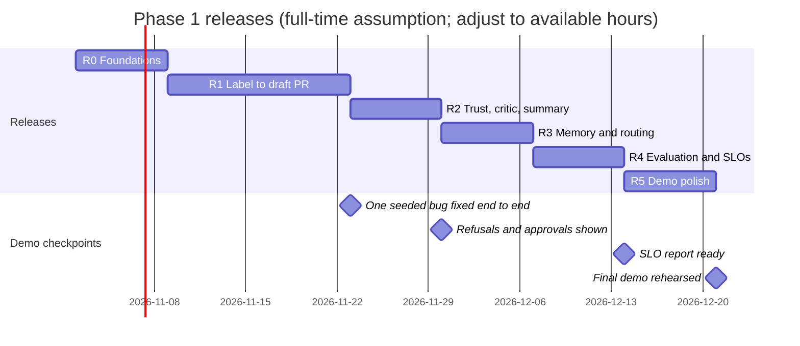

# Plan

**Audience:** builders and collaborators. **Status:** planned, not started. Restructured 28 Oct 2026 into demoable releases.

The MVP is the scope in [PITCH.md](PITCH.md). This plan says how to build it, in what order, and what to cut if time runs short. Pending items beyond the MVP are in [FUTURE-SCOPE.md](FUTURE-SCOPE.md).

## How this plan is shaped

Each release is a **thin, working slice that can be demoed on its own**. Nothing is built "for later": every release ends with a short demo on the fork, and each one adds to the last. If time runs out after any release, there is still a complete, honest demo to present.

Phase 1 (the capstone) is **Python repositories on GitHub only**. Java, C#, other code hosts, and other trackers are phase 2. The design already supports them (see [REPO-MEMORY.md](REPO-MEMORY.md) and [INTEGRATIONS.md](INTEGRATIONS.md)), so the viva line is: "built for many languages and hosts; phase 1 proves it on Python and GitHub."

## Decided before starting

- Phase 1 scope: Python repositories, GitHub only. The core trigger is a maintainer adding the `agent-fix` label to a GitHub issue.
- Extra intake (Langflow flow from Jira or Gmail) comes in release 5 and is the first thing cut if time is short. This replaces "Gmail only" as the MVP intake; see open item 22.
- Model: Azure OpenAI on the owner's personal subscription: `gpt-5.4-nano`, `gpt-5.4`, `text-embedding-3-large`. See [AZURE-SETUP.md](AZURE-SETUP.md).
- Memory: LlamaIndex collections in pgvector. See [REPO-MEMORY.md](REPO-MEMORY.md).
- Agents run as LangGraph sub-graphs in one process. Splitting them into A2A services is phase 2.
- A per-issue token cap protects against runaway loops.
- Forks are allowed. Licence: MIT.

## Roadmap

Seven weeks at full time. With fewer hours, the dates stretch and the cut list applies sooner.

## Releases

| Release | Weeks | What works at the end | Demo you can give | Rubric areas shown |
|---|---|---|---|---|
| R0 Foundations | 1 | Docker Compose (Postgres with pgvector, Langfuse), Azure smoke tests, FastAPI `/health`, fork with 10 seeded bugs | One model call traced in Langfuse; the seeded-bug list | Backend, observability |
| R1 Label to draft PR | 2–3 | Label → webhook → classify → research → failing test → patch → `/approve` comment → draft PR | Scene 5: one seeded bug fixed end to end | Architecture, tools, multi-agent, retrieval (basic) |
| R2 Trust, critic, summary | 4 | Refusal paths, audit log, critic and confidence, escalation, cited summary with approval | Scenes 4, 6, 7, 8: refusals, "won't answer", human gates | Human-in-the-loop, guardrails |
| R3 Memory and routing | 5 | Refresh on merge and `/agent reindex`, `fixes` collection, SQL tables, RAG/SQL/hybrid router | Merge a PR and watch memory update; one RAG, one SQL and one hybrid question | Retrieval and data (20%) |
| R4 Evaluation and SLOs | 6 | 50 golden queries, 10 seeded bugs run, red-team set, small-to-strong model escalation, SLO report | SLO dashboard with every target met or explained | SLO and evaluation |
| R5 Demo polish | 7 | React UI (runs, approvals, repos), Langflow intake and Slack approval flow, guide, rehearsal | The full 5-minute demo in [DEMO.md](DEMO.md) | Documentation and defence |

### R0: Foundations (week 1)

- Fork the reference repository (see below) and seed 10 Python bugs, each with a failing test and a known fixing file.
- `docker-compose.yml`: PostgreSQL with pgvector, Langfuse, the API.
- Azure checks from [AZURE-SETUP.md](AZURE-SETUP.md): smoke tests, supported parameters, quota.
- FastAPI skeleton, Pydantic settings, `.env.example`, pytest running in CI.
- Create the GitHub App for the fork.

**Demo:** a traced model call in Langfuse, and the seeded bugs listed with their failing tests.

### R1: Label to draft PR (weeks 2–3)

- Webhook receiver: signature check, duplicate deliveries ignored, label accepted only from listed maintainers.
- LangGraph graph with checkpoints in Postgres: classify (nano) → research → reproduce → patch (two attempts) → approval → draft PR.
- Research: full LlamaIndex index of the fork (`code` and `docs`), hybrid search filtered by repository.
- Sandbox: Docker with no network and no secrets; runs `pytest`.
- Approval for R1: a maintainer comments `/approve` on the issue. `interrupt()` pauses the graph until then.
- Langfuse trace for every run.

**Demo:** scene 5. A maintainer labels a seeded bug, the agent writes a failing test, patches it, waits for `/approve`, and opens a draft PR on `agent/issue-<n>`.

### R2: Trust, critic, and summary (week 4)

- Refusals: non-maintainer label, unknown author, instructions inside the issue body. Each is logged, with no work started.
- Append-only audit log.
- Critic node: tests pass, every claim cited, confidence score. Low confidence or an exhausted budget escalates to the maintainer with full context.
- "Not reproduced" path: a comment asking for specific detail, no patch.
- Summary agent: five-part root-cause summary with citations, behind its own approval.

**Demo:** scenes 4, 6, 7 and 8, showing when the agent refuses or chooses not to answer.

### R3: Memory and routing (week 5)

- Repo profiler (Python only in phase 1, with Java and C# detected and reported as "phase 2").
- Incremental refresh on PR merge and on `/agent reindex`; `index_state` and `index_runs` tables.
- `fixes` collection written when an agent PR is merged and its summary approved.
- SQL tool (read-only role) over runs, issues, costs and index tables.
- Router: RAG, SQL, or hybrid, with the route recorded in the trace.

**Demo:** merge the R1 PR and show the `index_runs` row; then ask "where is the date parsing code?" (RAG), "how many fixes merged this week and what did they cost?" (SQL), and "have we fixed a bug like this before?" (hybrid).

### R4: Evaluation and SLOs (week 6)

- 50 golden queries labelled with type, risk, retrieval mode and expected escalation (15 RAG, 10 SQL, 10 hybrid, 10 high-risk, 5 escalation).
- Run the 10 seeded bugs end to end, three times each, for pass^k.
- Red-team set: injection in issue text, forged events, attempts to push outside `agent/*`.
- Small-to-strong model escalation; measure cost and latency both ways.
- SLO report following [VERIFICATION.md](VERIFICATION.md).

**Demo:** the SLO dashboard, the routing confusion matrix, and the cost per issue.

### R5: Demo polish (week 7)

- React (Vite, TypeScript) UI with three screens: runs, approvals, repos and memory.
- Langflow intake flow (Jira or Gmail, decided by open item 22) calling `POST /runs`, and a Langflow Slack flow for approvals.
- Self-hosting guide; demo rehearsal twice in a row; recorded backup of every scene.

**Demo:** the full 5-minute demo.

## Phase 2 (after the capstone)

- Java and C# repositories through the repo profiler: splitter, test command, sandbox image.
- Other code hosts and trackers through the adapters in [INTEGRATIONS.md](INTEGRATIONS.md): GitLab, Bitbucket, CodeCommit, Jira, Zoho.
- Agents split into A2A services.
- Feature requests with spec approval, and the VS Code extension. See [FUTURE-SCOPE.md](FUTURE-SCOPE.md).

## Cut list

Cut from the top. Each release still stands on its own.

1. Langflow intake and Slack flow (R5): keep GitHub labels and `/approve` comments.
2. React UI (R5): demo through GitHub, the API, and Langfuse.
3. Graphify code graph: rely on hybrid search alone.
4. Small-to-strong model escalation (R4): run every node on `gpt-5.4` and accept the cost.
5. `conventions` collection (R3): keep only `fixes`.

Do not cut:
- signature checks and the maintainer and author allow-lists
- the approval gates for pushes, PRs, and summaries
- the citation check and the critic
- the RAG, SQL, and hybrid router (20% of the marks)
- the golden set and the security tests

These are what make the system safe to show, and they carry most of the marks.

## Risks

| Risk | Likelihood | Impact | Response |
|---|---|---|---|
| Scope exceeds seven weeks | High | High | Releases are demoable on their own; cut list above; phase 1 is Python and GitHub only |
| Langflow or Gmail set-up takes longer than expected | Medium | Low | It's in R5 and first on the cut list; GitHub labels cover intake |
| Model quality varies between deployments | Medium | Medium | Compare on the seeded set in week 1 and keep the better one |
| Patches pass tests but are wrong | High | High | Human approval; acceptance metric; test coverage stated in each summary |
| Prompt injection in a report | Medium | High | Report text treated as data; tool allow-list; security tests |
| Source code sent to the model provider | Certain with any hosted model | High | Azure OpenAI in the user's tenant; data-handling note in the guide |
| Cost overrun | Medium | Medium | Per-issue budget; two-attempt limit; measured baseline in week 2 |
| Rate limits on the model deployment | Medium | Low | Retry with backoff; surface the limit to the maintainer |

## Definition of done (phase 1)

- The GitHub path works end to end on seeded Python bugs, with the allow-lists enforced.
- The router answers RAG, SQL, and hybrid questions, and memory refreshes on merge.
- Every write action needs an approval, and the security tests pass.
- Summaries have citations, and none reaches a reporter without approval.
- The evaluation report exists, with targets met or explained.
- A new user can set up a fork from the guide in under 30 minutes.

## Open questions

1. Which reference repository, and who approves its use.
2. Decided 28 Oct 2026: `gpt-5.4-nano` for cheap steps and `gpt-5.4` for code and summaries. See [AZURE-SETUP.md](AZURE-SETUP.md).
3. The data-handling note for each deployment, including Azure's terms for the chosen resource.

## Reference repository (Phase 0)

Candidates, checked against the GitHub API in October 2026:

| Repo | Licence | Stars | Open issues | Last push | Notes |
|---|---|---|---|---|---|
| [python-attrs/attrs](https://github.com/python-attrs/attrs) | MIT | 5,860 | 174 | 13 Oct 2026 | Largest issue volume for triage; first pick |
| [fastapi/typer](https://github.com/fastapi/typer) | MIT | 20,186 | 48 | 15 Oct 2026 | Smaller backlog; fallback if attrs' suite is slow |
| [pallets/click](https://github.com/pallets/click) | BSD-3-Clause | 17,800 | 86 | 6 Oct 2026 | Larger codebase; less convenient to baseline |

Selection rules:
- Work on a fork. Live runs happen only on the fork, never on the upstream project.
- Upstream issue history is read-only evaluation data, used for the evaluation sets.
- Time the test suite on the build machine. The chosen repo's suite must finish in under ten minutes.
- Choose between the candidates on suite runtime, then on the number of reproducible historical bugs.
