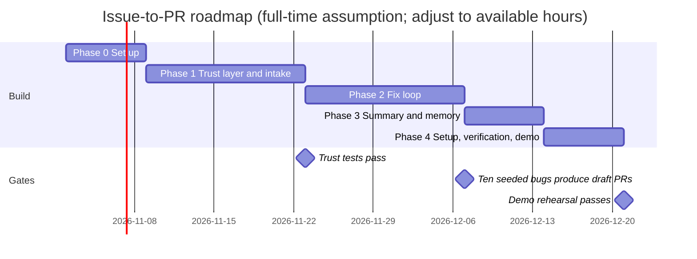

# Plan

**Audience:** builders and collaborators. **Status:** planned, not started.

The MVP is the scope in [PITCH.md](PITCH.md). This plan says how to build it, in what order, and what to cut if time runs short. Pending items beyond the MVP are in [FUTURE-SCOPE.md](FUTURE-SCOPE.md).

## Decided before starting

- Intake for the MVP: Gmail only.
- Repository provider for the MVP: GitHub only.
- Model: Azure OpenAI, using the user's own key and deployment.
- Users bring their own API keys, so cost is not a constraint for the MVP. A per-issue cap still exists to protect against runaway loops.
- Forks are allowed.
- Licence: MIT.

## Roadmap

The chart assumes full-time work for seven weeks. If the available hours are fewer, the dates move out in proportion, and the cut list applies sooner.

## Phases

### Phase 0: Set up (week 1)

- Choose the reference repository. Criteria: one the team controls, a test suite under ten minutes, and clear contribution rules.
- Build the code graph for it and keep the report.
- Choose the memory store: Mem0 for the MVP, unless the time-based questions in the evaluation need Graphiti.
- Azure OpenAI deployments created on 28 Oct 2026: `gpt-5.4-nano`, `gpt-5.4`, and `text-embedding-3-large`, on the owner's personal subscription. Run the week-1 checks in [AZURE-SETUP.md](AZURE-SETUP.md).
- Create the GitHub App and the Gmail OAuth client for the reference deployment.

**Exit:** reference repository chosen; code graph report saved; memory store chosen; model deployments and credentials in place.

### Phase 1: Trust layer and intake (weeks 2–3)

- Webhook receiver for GitHub: signature check, duplicate deliveries ignored, label trigger limited to listed maintainers, author allow-list.
- Gmail intake: read labelled messages, check SPF and DKIM against the sender's domain, drop unauthenticated and automated mail.
- Allow-list file per deployment, with one list for each channel.
- Generic "not permitted" reply, limited to one per sender per day.
- Audit log of every decision, with no message bodies.
- Intake extraction: title, steps, expected, and actual. Ask the reporter for missing fields rather than guessing.

**Exit:** on seeded test emails and events, every non-trusted path is refused or ignored, and every trusted path reaches the next stage. Each outcome appears in the audit log.

### Phase 2: Fix loop (weeks 4–5)

- Research agent: memory lookup, code-graph neighbourhood, and retrieval over code and docs.
- Reproduction agent: writes a failing test, runs it in the sandbox, and reports reproduced, not reproduced, or could not run.
- Patch agent: edits a branch named `agent/issue-<number>`, with a two-attempt limit.
- Sandbox: no network, no secrets, read-only mounts except the working copy, time and memory limits.
- Approval queue: a maintainer approves each push and each draft PR.

**Exit:** ten seeded bugs from allow-listed reporters produce draft PRs that pass the new test and keep the other tests passing. Unreproducible bugs produce a comment asking for detail, not a patch.

### Phase 3: Summary and memory (week 6)

- Summary agent: five-part summary with a citation on every claim. Uncited claims are removed.
- Approval for the summary before it goes to the reporter or the issue.
- Memory writes after merge: `bug_fix` and `root_cause` records, with provenance.

**Exit:** summaries reach the reporter and the issue only after approval, and no uncited claim survives in the test set.

### Phase 4: Setup, evaluation, and demo (week 7)

- Self-hosting guide: deploy with Docker Compose, set the allow-list, set keys, connect GitHub and Gmail.
- Evaluation run, following [VERIFICATION.md](VERIFICATION.md).
- Three-minute demo, and a short written report that includes the targets not met.

**Exit:** a new user can set up a fork from the guide in under 30 minutes, and the evaluation report is published.

## Cut list

If the schedule slips, cut in this order. Everything after the first item is a real loss, so cut the earlier items first.

1. Graphify incremental updates: re-run the full graph after each merge instead.
2. Small-to-strong model escalation: run every node on `gpt-5.4` if the escalation logic isn't ready, and accept the higher cost.
3. Richer memory: start with Mem0's simple records, without time-based queries.
4. Summary formatting polish: keep the five parts; drop extra styling.

Do not cut:
- allow-list checks and signature checks
- sender authentication for email
- the approval gates for pushes, PRs, and summaries
- the citation check
- the security tests

These are what make the system safe to show, and they are the reason for the project.

## Milestones

| Week | Milestone | Done when |
|---|---|---|
| 1 | Setup complete | Reference repo, code graph, memory store, model deployments, and credentials all in place |
| 2–3 | Trust and intake | Seeded emails and events behave as specified; audit log complete |
| 4–5 | Fix loop | Ten seeded bugs produce draft PRs; unreproducible bugs are handled |
| 6 | Summary and memory | Summaries need approval; memory records written on merge |
| 7 | Evaluation and demo | Report, guide, and demo complete |

## Risks

| Risk | Likelihood | Impact | Response |
|---|---|---|---|
| Scope exceeds seven weeks | High | High | Cut list above; MVP is GitHub and Gmail only |
| Gmail OAuth set-up takes longer than expected | Medium | Medium | Start the OAuth client in week 1; document the steps |
| Forwarded mail fails SPF | Medium | Low | Such mail is dropped, not trusted; this is documented behaviour |
| Model quality varies between deployments | Medium | Medium | Compare on the seeded set in week 1 and keep the better one |
| Patches pass tests but are wrong | High | High | Human approval; acceptance metric; test coverage stated in each summary |
| Prompt injection in a report | Medium | High | Report text treated as data; tool allow-list; security tests |
| Source code sent to the model provider | Certain with any hosted model | High | Azure OpenAI in the user's tenant; data-handling note in the guide |
| Cost overrun | Medium | Medium | Per-issue budget; two-attempt limit; measured baseline in week 2 |
| Rate limits on the model deployment | Medium | Low | Retry with backoff; surface the limit to the maintainer |

## Definition of done (MVP)

- The GitHub path works end to end on seeded bugs, with the allow-list enforced.
- Gmail intake works end to end, with sender checks, the allow-list, and the generic reply.
- Every write action needs an approval, and the security tests pass.
- Summaries have citations, and none reaches a reporter without approval.
- The evaluation report exists, with targets met or explained.
- A new user can set up a fork from the guide in under 30 minutes.

## Open questions

1. Which reference repository, and who approves its use.
2. Decided 28 Oct 2026: `gpt-5.4-nano` for cheap steps and `gpt-5.4` for code and summaries. See [AZURE-SETUP.md](AZURE-SETUP.md).
3. The data-handling note for each deployment, including Azure's terms for the chosen resource.

## Reference repository (Phase 0)

Candidates, checked against the GitHub API in October 2026:

| Repo | Licence | Stars | Open issues | Last push | Notes |
|---|---|---|---|---|---|
| [python-attrs/attrs](https://github.com/python-attrs/attrs) | MIT | 5,860 | 174 | 13 Oct 2026 | Largest issue volume for triage; first pick |
| [fastapi/typer](https://github.com/fastapi/typer) | MIT | 20,186 | 48 | 15 Oct 2026 | Smaller backlog; fallback if attrs' suite is slow |
| [pallets/click](https://github.com/pallets/click) | BSD-3-Clause | 17,800 | 86 | 6 Oct 2026 | Larger codebase; less convenient to baseline |

Selection rules:
- Work on a fork. Live runs happen only on the fork, never on the upstream project.
- Upstream issue history is read-only evaluation data, used for the evaluation sets.
- Time the test suite on the build machine. The chosen repo's suite must finish in under ten minutes.
- Choose between the candidates on suite runtime, then on the number of reproducible historical bugs.
