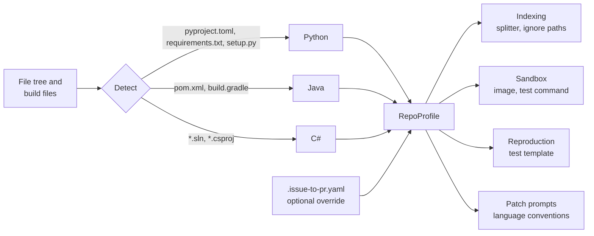
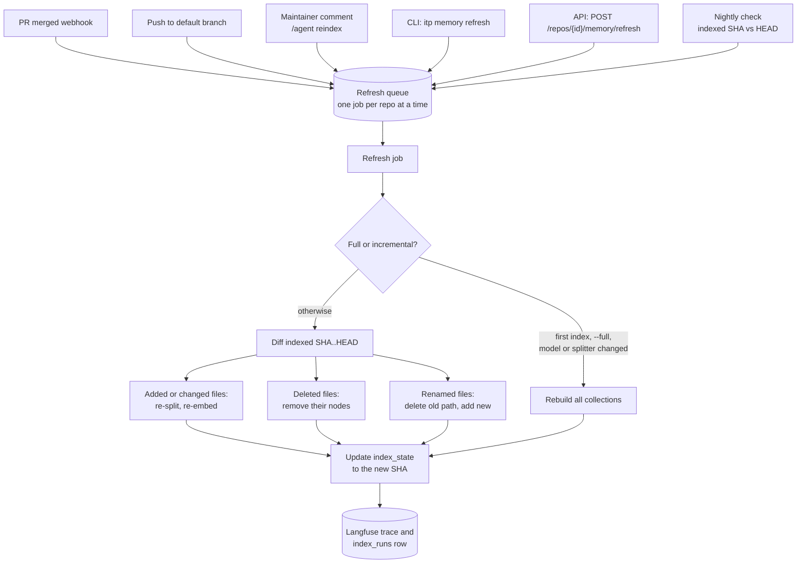

# Repository memory

**Audience:** builders and architecture review. **Status:** design, 28 Oct 2026. Library calls are sketches; check them against the pinned LlamaIndex version before coding.

The agent keeps an "AI memory" of every connected repository: its code, its docs, and what past fixes taught it. LlamaIndex builds and updates this memory. It works for several repositories at once, in Python, Java, or C#, and decides how to handle each repository from what it finds there.

## Goals

1. **Fresh.** The memory is updated when a pull request is merged, and on demand with a manual command.
2. **Cheap to update.** Only changed files are re-read and re-embedded.
3. **Many repositories.** One deployment serves several repositories, kept apart by a `repo` filter.
4. **Language-aware.** Python, Java, and C# are each split along functions and classes, with the right test runner chosen per repository.
5. **Traceable.** Every chunk records the repository, file, line range, and commit it came from.

## What the memory holds

| Collection | Contents | Chunking | Written when |
|---|---|---|---|
| `code` | Functions, methods, and classes | LlamaIndex `CodeSplitter` (tree-sitter) per language | Merge, push to default branch, manual refresh |
| `docs` | README, docs folder, contributing guide | Markdown split by heading | Same |
| `fixes` | Each merged agent PR: issue, root cause, changed files, test added | One node per fix | PR merged **and** summary approved |
| `conventions` | Error-handling style, test layout, naming, from the contributing guide | One node per rule | Guide changes, or manual refresh |

All four live in PostgreSQL with pgvector in one table per collection, with `repo` as a metadata filter. Keyword search uses PostgreSQL full-text search on the same rows, so hybrid search needs no second system.

**Decided 28 Oct 2026:** the `fixes` and `conventions` collections take over the job planned for Mem0 (open item 7, closed). That leaves one memory technology to build and explain in the viva. Mem0 or Graphiti can come back later if time-based questions need them.

## Deciding per repository: the repo profiler

When a repository is connected, and again on every refresh, a profiler reads the file tree and build files. Its result is a `RepoProfile`, which every later step uses.



| Decision | Python | Java | C# |
|---|---|---|---|
| Detected by | `pyproject.toml`, `requirements.txt`, `setup.py`, `*.py` share | `pom.xml`, `build.gradle(.kts)`, `*.java` share | `*.sln`, `*.csproj`, `*.cs` share |
| `CodeSplitter` language | `python` | `java` | `c_sharp` |
| Ignore paths | `.venv/`, `__pycache__/`, `build/`, `dist/` | `target/`, `build/`, `.gradle/` | `bin/`, `obj/`, `packages/` |
| Test framework (detected) | pytest | JUnit 5 (Maven or Gradle) | xUnit, NUnit, or MSTest |
| Test command | `pytest -x -q` | `mvn -q test` or `./gradlew test` | `dotnet test` |
| Sandbox image | `python:3.12-slim` | Maven or Gradle with a Temurin JDK | `mcr.microsoft.com/dotnet/sdk:8.0` |
| Failing-test template | `tests/test_issue_<n>.py` | `src/test/java/.../Issue<n>Test.java` | `<Project>.Tests/Issue<n>Tests.cs` |

Rules:

- **Mixed repositories:** each file is split by its own extension. The test runner follows the language with the most source lines, unless the override file says otherwise.
- **Unknown language:** files are indexed as plain text, and the reproduction step is skipped with a clear message to the maintainer. The agent does not guess a test runner.
- **Override:** `.issue-to-pr.yaml` in the repository can set the language, test command, image, and ignore paths. It is read from the default branch only, so a pull request can't change how the agent runs.
- Pin image versions in the deployment config rather than the floating tags shown above.

```yaml
# .issue-to-pr.yaml (optional, in the target repository)
language: csharp
test_command: dotnet test tests/Api.Tests
sandbox_image: mcr.microsoft.com/dotnet/sdk:8.0
ignore: ["samples/", "**/*.Designer.cs"]
```

## When the memory updates



| Trigger | Who can use it | What runs |
|---|---|---|
| PR merged (`pull_request` closed with `merged = true`) | Automatic | Incremental refresh of the base branch; a `fixes` node if the PR was the agent's and its summary was approved |
| Push to the default branch | Automatic | Incremental refresh (catches direct pushes) |
| `/agent reindex` comment | Listed maintainers only | Incremental; `/agent reindex --full` rebuilds |
| `itp memory refresh --repo owner/name [--full]` | Operator | Same, from the command line |
| `POST /repos/{id}/memory/refresh` | Admin role | Same, from the API, a Langflow button, or a script |
| Nightly check | Automatic | Refreshes any repository whose indexed SHA is behind HEAD, in case a webhook was missed |

Safety rules:

- **One refresh per repository at a time**, using a PostgreSQL advisory lock on the repository ID. A second request while one is running is queued, not run in parallel.
- **Idempotent.** A job keyed by the target SHA that has already finished does nothing.
- **Unchanged chunks are skipped.** LlamaIndex's ingestion pipeline keeps a hash per document, so an unchanged file costs no embedding calls.
- **Only the default branch is indexed.** Code from an unmerged pull request never enters memory, so a contributor can't plant false context.
- **Full rebuild when the setup changes:** a new embedding model, new `dimensions`, or a new splitter version. The index stores all three.

## Building it with LlamaIndex

A sketch of the refresh job. Names follow LlamaIndex's current packages (`llama-index-core`, `llama-index-vector-stores-postgres`, `llama-index-embeddings-azure-openai`); confirm the signatures against the version you pin.

```python
from llama_index.core import Document
from llama_index.core.ingestion import IngestionPipeline, DocstoreStrategy
from llama_index.core.node_parser import CodeSplitter, MarkdownNodeParser
from llama_index.core.storage.docstore import SimpleDocumentStore  # or a Postgres-backed docstore
from llama_index.vector_stores.postgres import PGVectorStore
from llama_index.embeddings.azure_openai import AzureOpenAIEmbedding

embed = AzureOpenAIEmbedding(
    model="text-embedding-3-large",
    deployment_name=settings.AZURE_OPENAI_DEPLOYMENT_EMBED,
    dimensions=1536,                      # must match vector(1536)
    azure_endpoint=settings.AZURE_OPENAI_ENDPOINT,
    api_version=settings.AZURE_OPENAI_API_VERSION,
)

code_store = PGVectorStore.from_params(
    table_name="code", embed_dim=1536, hybrid_search=True, **pg_params
)

SPLITTERS = {
    "python": CodeSplitter(language="python", chunk_lines=60, chunk_lines_overlap=10, max_chars=2500),
    "java":   CodeSplitter(language="java",   chunk_lines=60, chunk_lines_overlap=10, max_chars=2500),
    "csharp": CodeSplitter(language="c_sharp", chunk_lines=60, chunk_lines_overlap=10, max_chars=2500),
}

def to_document(repo, path, text, sha, lang):
    # doc_id is stable per repo and file, so a changed file replaces its old nodes
    return Document(
        text=text,
        doc_id=f"{repo.id}:{path}",
        metadata={"repo": repo.full_name, "path": path, "language": lang, "commit": sha},
        excluded_embed_metadata_keys=["commit"],
    )

def refresh(repo, full=False):
    profile = profile_repo(repo)                     # the repo profiler above
    old_sha = index_state.get(repo.id)
    new_sha = repo.head_sha()
    if not full and old_sha == new_sha:
        return                                       # already up to date

    changes = repo.full_tree(new_sha) if full or old_sha is None else repo.diff(old_sha, new_sha)

    for path in changes.deleted + changes.renamed_from:
        code_store.delete(ref_doc_id=f"{repo.id}:{path}")
        docstore_for(repo).delete_ref_doc(f"{repo.id}:{path}", raise_error=False)

    docs_by_lang = group_by_language(changes.added_or_modified, profile)
    for lang, docs in docs_by_lang.items():
        pipeline = IngestionPipeline(
            transformations=[SPLITTERS.get(lang, default_text_splitter), embed],
            vector_store=code_store,
            docstore=docstore_for(repo),
            docstore_strategy=DocstoreStrategy.UPSERTS,   # skip unchanged, replace changed
        )
        pipeline.run(documents=docs)

    index_state.set(repo.id, new_sha, embed_model="text-embedding-3-large", dims=1536)
```

Retrieval always filters by repository and returns file, lines, and commit:

```python
from llama_index.core import VectorStoreIndex
from llama_index.core.vector_stores import MetadataFilters, ExactMatchFilter

retriever = VectorStoreIndex.from_vector_store(code_store, embed_model=embed).as_retriever(
    similarity_top_k=20,
    vector_store_query_mode="hybrid",
    filters=MetadataFilters(filters=[ExactMatchFilter(key="repo", value=repo.full_name)]),
)
```

## Tables for the SQL route

These also give the router real SQL questions to answer.

```sql
repos(id PK, full_name UNIQUE, provider, default_branch, connected_at)
repo_profiles(repo_id FK, languages[], primary_language, test_command, sandbox_image,
              source, detected_at)            -- source: detected or override
index_state(repo_id FK, branch, indexed_sha, embed_model, embed_dims, splitter_version, updated_at)
index_runs(id PK, repo_id FK, trigger, from_sha, to_sha, full, files_changed, files_deleted,
           chunks_upserted, embed_tokens, cost, duration_ms, status, started_at)
```

Example questions: "Which repositories are behind HEAD?", "How much did re-indexing cost last week?", "Which repositories are C#, and what test command do they use?"

## Measures

| Measure | Target |
|---|---|
| Freshness: time from merge to indexed | Under 5 minutes for a typical PR |
| Stale results: hits from a commit older than the indexed head | 0 |
| Incremental cost: embedding tokens for a 5-file PR vs a full rebuild | Under 5% of full |
| Recall at five on the seeded bugs, per language | At least 70% for each of Python, Java, and C# |
| Profiler accuracy on the test repositories | 100% for language and test command |

## Demo scene

1. Merge a PR on the Python test repository. Show the `index_runs` row: 3 files changed, chunks upserted, cost.
2. Comment `/agent reindex` on the C# repository as a maintainer. Show the profiler picking `dotnet test` and the right image.
3. Ask the router "which repositories are behind HEAD?" and show the SQL answer.

## Build order

1. Repo profiler with tests on three small public repositories, one per language.
2. Full index for one repository, then retrieval with the `repo` filter.
3. Incremental refresh from a diff, with deletes and renames.
4. Merge webhook and `/agent reindex`, then the CLI and API.
5. Nightly check, `index_runs`, and the Langfuse trace.
