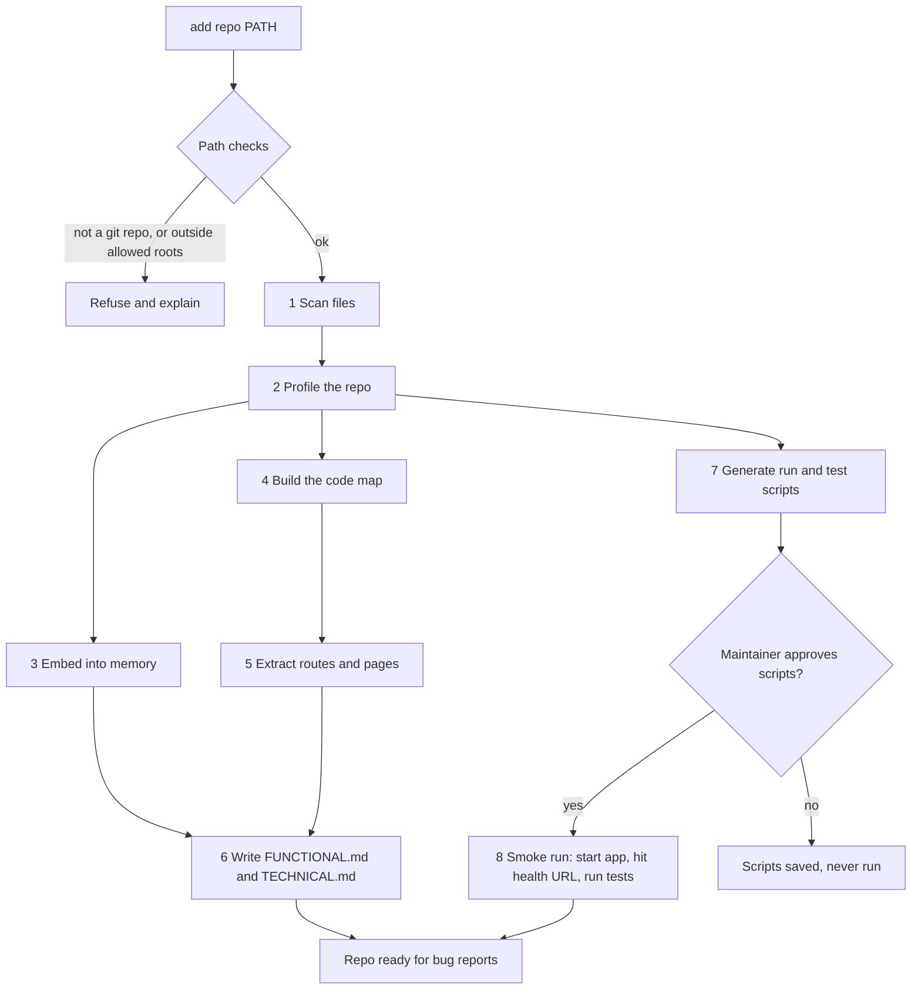
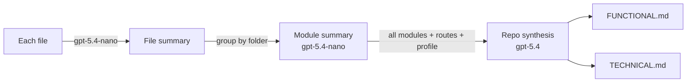
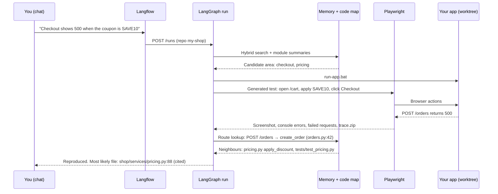

# Repository onboarding

**Audience:** builders, owner, architecture review. **Status:** design, 28 Oct 2026. Library calls are sketches; check them against the pinned versions before coding.

This is what happens when you point the agent at a folder on your machine. In one pass it reads the whole repository, builds its memory and a map of how the files connect, writes a functional and a technical description of the app, generates scripts to run and test it, and learns enough to reproduce UI bugs in a browser with Playwright. After that, a bug typed into the chat box can be traced to the file that most likely causes it.

It extends [REPO-MEMORY.md](REPO-MEMORY.md) (how the memory is stored and refreshed) and [CHAT-AND-LOCAL-MODE.md](CHAT-AND-LOCAL-MODE.md) (the chat box and local git adapter).

## What you do

Pick one of these. All three call the same endpoint, `POST /repos`.

| Where | What you type |
|---|---|
| Chat box | `add repo C:\code\my-shop` |
| Command line | `itp repo add --path C:\code\my-shop --name my-shop` |
| API | `POST /repos {"path": "C:\\code\\my-shop", "name": "my-shop"}` |

The chat then shows progress until onboarding finishes:

```text
my-shop: scanning... 412 files, 37 skipped (.gitignore, binaries, secrets)
my-shop: profile = Python 3.12, FastAPI, pytest, React front end in /web
my-shop: embedded 2,318 chunks (code 1,904, docs 414)
my-shop: code map = 388 files, 1,240 symbols, 2,965 edges, 41 routes
my-shop: wrote FUNCTIONAL.md and TECHNICAL.md
my-shop: run-app.bat and run-tests.bat are ready. Type "approve scripts my-shop" to allow them to run.
```

## The onboarding pipeline



Steps 3 and 4 run in parallel. Each step writes a row to `index_runs`, so a failure in one step can be retried without starting over.

### 1. Scan

- Walk the folder with `git ls-files` (tracked files) plus untracked files that `.gitignore` does not exclude. This respects `.gitignore` for free.
- Skip binaries (by extension and a null-byte check), files over 1 MB, lock files, `node_modules`, `.venv`, `dist`, `build`, and minified JavaScript.
- **Never read secrets.** Skip `.env*`, `*.pem`, `*.key`, `*.pfx`, `id_rsa*`, `secrets.*`, and any file whose name matches the deny list in `.issue-to-pr.yaml`. A regex secret scan (AWS keys, Azure keys, private-key headers, connection strings) runs on every file before it is embedded; a hit drops the file and logs its path, never its contents.
- Record each file's path, size, language, and git blob hash in `repo_files`. The blob hash is what makes later refreshes incremental.

### 2. Profile

The repo profiler from [REPO-MEMORY.md](REPO-MEMORY.md) is extended to detect frameworks and how to run the app, not only the language.

| Signal | Detected as | Run command | Default health URL |
|---|---|---|---|
| `fastapi` in requirements, `FastAPI(` in code | FastAPI | `uvicorn <module>:app --port 8000` | `http://127.0.0.1:8000/docs` |
| `flask` in requirements, `Flask(__name__)` | Flask | `flask --app <module> run --port 5000` | `http://127.0.0.1:5000/` |
| `manage.py` with `django` | Django | `python manage.py runserver 8000` | `http://127.0.0.1:8000/` |
| `package.json` with a `dev` or `start` script | Node or React front end | `npm run dev` | port from `vite.config` or `3000` |
| `docker-compose.yml` | Compose app | `docker compose up` | first published port |
| `pytest` in dev requirements or a `tests/` folder | pytest | `python -m pytest -q` | n/a |
| none of the above | Library | no run script; tests only | n/a |

Java (`pom.xml`, `build.gradle`) and C# (`*.sln`, `*.csproj`) are detected and reported as "phase 2" in phase 1.

The module that holds `app` is found from the code map (step 4), not guessed. When more than one candidate exists, the chat asks: "I found two FastAPI apps, `api/main.py` and `admin/app.py`. Which one should run-app.bat start?"

A `.issue-to-pr.yaml` on the default branch overrides any detected value, for example:

```yaml
run: uvicorn shop.api:app --port 8100
health_url: http://127.0.0.1:8100/health
test: python -m pytest -q tests/unit
ui_base_url: http://127.0.0.1:5173
skip: ["data/**", "notebooks/**"]
```

### 3. Embed into memory

Unchanged from [REPO-MEMORY.md](REPO-MEMORY.md): code is split along functions and classes with `CodeSplitter`, docs are split by heading, and both go into the `code` and `docs` collections with `text-embedding-3-large` at 1536 dimensions. Every chunk carries `repo`, `path`, `start_line`, `end_line`, `symbol`, and `commit`.

Onboarding adds a fifth collection, `summaries`, written in step 6:

| Level | One node per | Used to answer |
|---|---|---|
| Repository | repo | "What does this app do?" |
| Module | folder or package | "Where is checkout handled?" |
| File | source file | First-pass file ranking for a bug |

Retrieval for a bug goes top down: module summaries narrow the area, file summaries rank files, and `code` chunks give the exact lines. This keeps large repos fast and makes the reason for each pick explainable.

### 4. Build the code map

The code map records which files and symbols depend on each other. It answers questions vector search cannot: "what calls this function?" and "if this route fails, which files are involved?"

**Choice:** our own map, built with Python's `ast` module for Python files and tree-sitter for JavaScript and TypeScript, stored in PostgreSQL. Graphify stays optional (open item 8 is still unverified) and Mem0 is not used; LlamaIndex is the memory, as decided on 28 Oct 2026. If Graphify proves itself on the reference repo, its output can be loaded into the same tables.

What is extracted per file:

| Edge kind | From → to | Example |
|---|---|---|
| `imports` | file → file | `shop/api/orders.py` → `shop/services/pricing.py` |
| `defines` | file → symbol | `pricing.py` → `apply_discount` |
| `calls` | symbol → symbol (best effort, by name) | `create_order` → `apply_discount` |
| `handles` | route → symbol | `POST /orders` → `create_order` |
| `tests` | test file → file under test | `tests/test_pricing.py` → `pricing.py` (by import) |
| `renders` | front-end page → API route | `web/src/pages/Cart.tsx` → `POST /orders` (by `fetch` or `axios` URL) |

Tables:

```sql
CREATE TABLE code_nodes (
  id         bigserial PRIMARY KEY,
  repo_id    int  NOT NULL REFERENCES repos(id),
  kind       text NOT NULL,          -- file | symbol | route | page
  name       text NOT NULL,          -- path, qualified name, "POST /orders"
  path       text,
  start_line int,
  end_line   int,
  commit     text NOT NULL,
  UNIQUE (repo_id, kind, name)
);

CREATE TABLE code_edges (
  repo_id int  NOT NULL REFERENCES repos(id),
  src     bigint NOT NULL REFERENCES code_nodes(id) ON DELETE CASCADE,
  dst     bigint NOT NULL REFERENCES code_nodes(id) ON DELETE CASCADE,
  kind    text NOT NULL,             -- imports | defines | calls | handles | tests | renders
  PRIMARY KEY (src, dst, kind)
);
```

Neighbours of a file, two hops out, are one recursive SQL query. No graph database is needed for a repo of a few thousand files. On refresh, rows for changed files are deleted and rebuilt; everything else stays.

### 5. Extract routes and pages

A dedicated pass fills the `routes` view of the code map, because routes are how a browser error leads back to code.

| Framework | How routes are found |
|---|---|
| FastAPI | `@app.get("/x")`, `@router.post(...)` decorators plus `APIRouter(prefix=...)` and `include_router` |
| Flask | `@app.route("/x", methods=[...])`, blueprints with `url_prefix` |
| Django | `urlpatterns` with `path()` and `include()` |
| React Router | `<Route path=...>` and `createBrowserRouter` entries |

Each route row stores method, path pattern, handler symbol, and file and line. The run-time check in step 8 confirms the list against FastAPI's `/openapi.json` when it is available.

### 6. Write FUNCTIONAL.md and TECHNICAL.md

These describe the repository that was added, so the agent (and you) have a readable picture of it. They are generated by map-reduce so that no single model call has to read the whole repo.



| Document | Sections |
|---|---|
| `FUNCTIONAL.md` | What the app does; user roles; features, each with the pages and routes behind it; main user journeys (for example "add to cart → checkout → order confirmation"); business rules found in code (discounts, validation limits); known gaps (TODOs, skipped tests) |
| `TECHNICAL.md` | Stack and versions; folder map; module responsibilities; route table; data model (ORM models or SQL migrations); external services and config keys (names only, never values); how to run and test; code-map diagram of the top modules (Mermaid); test coverage by module |

Rules:
- Every statement cites a file and line range, like the bug summaries. A sentence the critic cannot tie to a citation is removed.
- The files are written to the agent's data folder, `data/repos/my-shop/FUNCTIONAL.md`, not into your repo. Copying them into the repo is your choice.
- They are regenerated only for modules whose files changed, on each refresh.
- Cost guide: about 400 nano calls and 1 strong call for a 400-file repo. Check this against your Azure quota before onboarding a large repo.

### 7. Generate run and test scripts

From the profile, the agent writes four scripts into `data/repos/my-shop/scripts/`: `run-app.bat` and `run-tests.bat` for Windows, and `.sh` versions for Linux and Docker.

Example `run-app.bat` for a FastAPI app:

```bat
@echo off
REM Generated by issue-to-pr for my-shop. Review before approving.
setlocal
cd /d "%ITP_WORKTREE%"
if not exist .venv (
  py -3.12 -m venv .venv || exit /b 1
)
call .venv\Scripts\activate.bat
python -m pip install -q -r requirements.txt || exit /b 1
start "my-shop-api" /b uvicorn shop.api:app --host 127.0.0.1 --port 8000
call "%~dp0wait-for-url.bat" http://127.0.0.1:8000/docs 60 || exit /b 1
echo my-shop is up on http://127.0.0.1:8000
```

Example `run-tests.bat`:

```bat
@echo off
setlocal
cd /d "%ITP_WORKTREE%"
call .venv\Scripts\activate.bat
python -m pytest -q %* --junitxml=report.xml
exit /b %ERRORLEVEL%
```

Rules:
- `%ITP_WORKTREE%` points at a worktree under `.itp-worktrees/`, never at your own checkout.
- Scripts are generated from fixed templates filled with profile values. The model never writes free-form shell commands, which closes off injection through a crafted README.
- **Nothing runs until you approve.** Type `approve scripts my-shop` in chat. The approval is stored with a hash of each script; if a script changes, it needs approving again.
- The app binds to `127.0.0.1` only. Tests still run in the Docker sandbox with no network, as before.

### 8. Smoke run

After approval, the agent starts the app with `run-app.bat`, waits for the health URL, fetches `/openapi.json` if it exists to check the route table, runs `run-tests.bat` once to record the baseline (which tests already fail), and stops the app. The baseline matters later: a bug fix must not break a test that passed at onboarding.

## Tracing a bug from the chat to a file

This is the part of the demo that shows the memory paying off.



### Steps

1. **Understand.** The intake agent (nano) extracts the page, action, input, and expected and actual result. If the page is missing, it asks.
2. **Narrow with memory.** Hybrid search over `summaries` and `code`, filtered to the repo, gives a first list of candidate files with scores.
3. **Reproduce in the browser** (UI bugs only). The reproduction agent writes a `pytest-playwright` test from a fixed template: open the page, perform the steps, assert the expected result. It fills the template with selectors taken from the page's front-end source (found through the `renders` edges), not invented ones. It runs against the app started by `run-app.bat`.
4. **Capture evidence.** The Playwright run records:
   - a screenshot at the failure
   - browser console errors (`page.on("console")`)
   - failed network calls with status 4xx or 5xx (`page.on("response")`)
   - the server log lines printed during the test
   - `trace.zip`, which opens in the Playwright trace viewer for the demo
5. **Follow the evidence to code.**
   - A failed request (`POST /orders` 500) is matched to the `routes` table, which gives the handler and file.
   - A Python traceback in the server log gives file and line directly; it ranks highest.
   - A console error with a source path maps to a front-end file.
   - The code map then adds neighbours: what the handler calls, and which tests cover it.
6. **Rank and explain.** Candidates are scored from four signals: traceback hit, route match, code-map distance, and retrieval score. The top three are shown with the reason for each. The patch agent starts from the top file.
7. **Lock it in.** The Playwright test becomes the failing test for the fix. It must fail before the patch and pass after it, the same rule as for pytest.

For non-UI bugs (a wrong calculation, a failing function), step 3 is skipped and the reproduction agent writes a plain pytest test, as in R1.

### Playwright setup

- `pip install pytest-playwright` and `playwright install chromium` in the agent's own environment, not in your repo's.
- The browser runs headless on the host and only reaches `127.0.0.1`. The generated test file lives in the worktree under `tests/e2e/`, so it is part of the fix branch if you approve it.
- Time limit: 60 seconds per reproduction attempt, two attempts, then the run escalates to you with whatever evidence it has.
- Playwright needs a web app to drive. A library repo (no run script) uses pytest reproduction only.

## Our own app: start scripts

The agent itself also gets one-click scripts, added in R0:

| Script | What it does |
|---|---|
| `scripts\setup.bat` | Checks Python 3.12, Docker, and Git; creates `.venv`; installs requirements; runs `playwright install chromium`; copies `.env.example` to `.env` if missing |
| `scripts\start.bat` | `docker compose up -d` (Postgres with pgvector, Langfuse, Langflow), waits for Postgres, runs migrations, starts the API on `127.0.0.1:8080`, and prints the Langflow chat URL |
| `scripts\stop.bat` | Stops the API and `docker compose down` |
| `scripts\e2e.bat` | Runs the agent's own Playwright tests against the Langflow chat: sends a seeded bug, waits for the reproduction, and checks that the expected file is in the top three |

`scripts\e2e.bat` doubles as evaluation: the 10 seeded bugs each have a known fixing file, so "right file in top three" becomes a measured SLO (target: at least 8 of 10).

## API and chat additions

| Endpoint or command | Purpose |
|---|---|
| `POST /repos` | Register a folder and start onboarding |
| `GET /repos/{id}/onboarding` | Progress of each step |
| `GET /repos/{id}/docs/functional`, `/technical` | The generated documents |
| `GET /repos/{id}/map?path=...&depth=2` | Code-map neighbours of a file |
| `GET /repos/{id}/routes` | Route table |
| `POST /repos/{id}/scripts/approve` | Approve the generated scripts |
| `add repo PATH` (chat) | Same as `POST /repos` |
| `approve scripts NAME` (chat) | Same as scripts approve |
| `explain NAME` (chat) | Shows the repo summary from FUNCTIONAL.md |
| `where NAME "text"` (chat) | Ranked files for a description, without starting a fix |

## New tables

| Table | Holds |
|---|---|
| `repo_files` | Path, language, size, blob hash, skipped reason |
| `code_nodes`, `code_edges` | The code map |
| `repo_scripts` | Script name, content hash, approved by, approved at |
| `onboarding_steps` | Step, status, started, finished, error (one row per step per run) |

These sit next to `repos`, `repo_profiles`, `index_state`, and `index_runs` from [REPO-MEMORY.md](REPO-MEMORY.md).

## Where this lands in the plan

| Release | Onboarding work |
|---|---|
| R0 | `scripts\setup.bat`, `start.bat`, `stop.bat`; `add repo` with scan, profile, and embed; progress in chat |
| R1 | Run and test script generation with approval; smoke run and test baseline |
| R2 | FUNCTIONAL.md and TECHNICAL.md with citations; `summaries` collection |
| R3 | Code map and route table; ranked "most likely file"; Playwright reproduction and evidence; `where` command |
| R4 | `scripts\e2e.bat` and the "right file in top three" SLO |

## Choosing the target repository

Playwright needs an app with pages. The reference library from the plan has none, so for the demo use one of:

1. Your own small Python web app (FastAPI or Flask with a simple front end), not an employer's code.
2. A public FastAPI example app with a front end, cloned locally, with the 10 seeded bugs split between API logic and UI flow.

Keep the library repo for the pytest-only path if you want to show both.

## Risks

| Risk | Response |
|---|---|
| Large repos make onboarding slow or costly | `skip` globs, the 1 MB file limit, and a cost estimate shown before step 6 starts |
| The run script fails on your machine | The chat shows the failing step and its output; you edit `.issue-to-pr.yaml` and retry from that step |
| Generated Playwright selectors are wrong | Selectors come from the front-end source; on failure, the test is retried once with the page's accessibility tree as extra context, then escalated |
| A secret slips into an embedding | Deny-list plus regex scan before embedding; the `repo_files` skipped reason is reviewable in the UI |
| The app under test calls the internet | It binds to `127.0.0.1`; outbound calls are out of scope for phase 1 and logged when seen in the server log |
