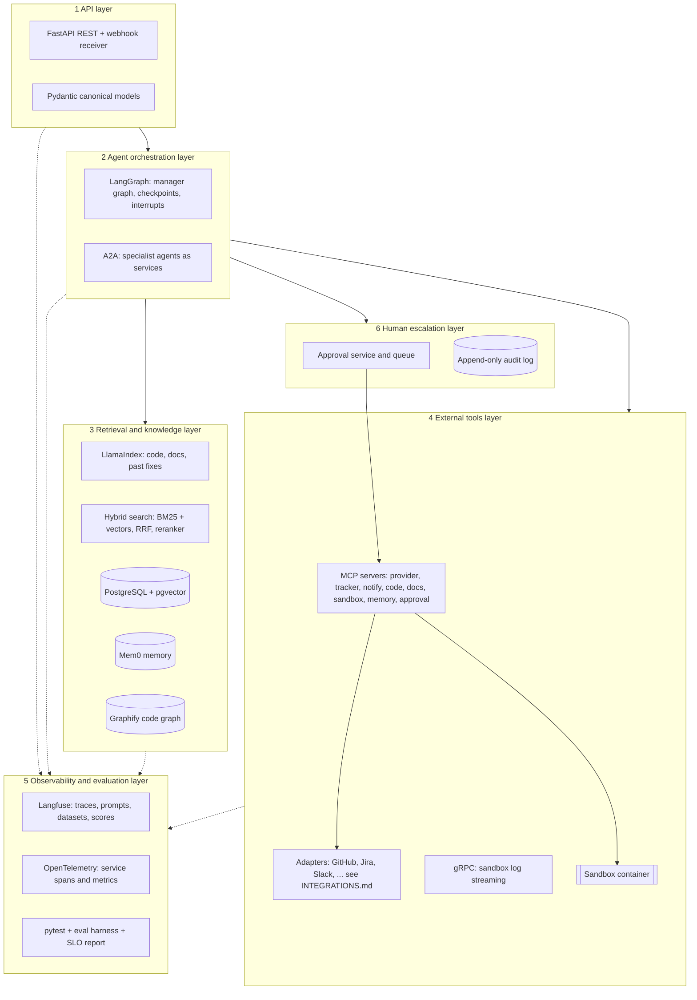

# Technology

**Audience:** builders, mentor, and reviewers. **Status:** proposal; versions are pinned at the start of the build (open item 11).

This document lists every technology in the agent, the job it does, why it was chosen, and what was considered instead. It also maps the stack to the NIIT capstone's six required layers.

## Stack at a glance

Dotted lines are telemetry. Every layer reports to Langfuse and OpenTelemetry.

## Technologies by layer

### 1. API layer

| Technology | Role | Why | Alternative considered |
|---|---|---|---|
| **Python 3.12** | Every service | Ecosystem for LangGraph, LlamaIndex, and the vendor SDKs | TypeScript: weaker agent and retrieval libraries |
| **FastAPI** | REST endpoints and webhook receiver | Async, typed, generates an OpenAPI spec | Flask: no native async or typing |
| **Pydantic v2** | Canonical events, issues, change requests, approvals | One validated contract between adapters and agents | Plain dictionaries: no validation boundary |

### 2. Agent orchestration layer

| Technology | Role | Why | Alternative considered |
|---|---|---|---|
| **LangGraph** | Manager graph: classify, research, reproduce, patch, summarise; retries and budgets | Stateful graphs, checkpoints, and `interrupt` for approvals | CrewAI: less control over state and resumption |
| **A2A** | Specialist agents as separate services with Agent Cards | Visible boundaries and task states between agents | In-process sub-graphs: simpler, used if the schedule slips |
| **Azure OpenAI** | `gpt-5.4-nano` for extraction, classification, routing, and SQL; `gpt-5.4` for tests, patches, and summaries; `text-embedding-ada-002` for search. See [AZURE-SETUP.md](AZURE-SETUP.md) | Runs in the user's tenant with their own key; the cheap model handles most calls | Other providers behind the model setting (future) |

### 3. Retrieval and knowledge layer

| Technology | Role | Why | Alternative considered |
|---|---|---|---|
| **LlamaIndex** | Ingestion and retrieval over code, docs, and past fixes, with file and line metadata | Code-aware chunking and citations | LangChain retrievers: more glue code |
| **BM25 + dense vectors** | Hybrid search, fused with Reciprocal Rank Fusion, then reranked | Identifiers and error strings need BM25; symptoms in prose need vectors | Vectors only: misses exact symbol names |
| **PostgreSQL + pgvector** | Task and audit store, vector index, structured run data | One database for SQL questions and vectors | A separate vector DB such as Qdrant: another service to run |
| **Mem0** | Memory of past fixes, root causes, module owners | Simple records with provenance | Graphiti: if time-based questions need it (open item 7) |
| **Graphify** | Code graph of file dependencies | Neighbourhood search around a failing file | Tree-sitter call graph built by hand |

The router sends each question to the right source: **RAG** for code and docs, **SQL** for run history ("fixes merged in `auth/` last month, and their cost"), or **hybrid** ("have we fixed a bug like this before, and which files did it touch?"). See open item 24.

### 4. External tools layer

| Technology | Role | Why | Alternative considered |
|---|---|---|---|
| **MCP** | Governed tool layer; write tools need an approval token | One audit point for every action | Direct API calls from agents: no single control point |
| **Adapters** | CodeHost, Tracker, Notifier ports; GitHub, Jira, Slack first | Any organisation's tools without changing the pipeline | One hard-coded provider |
| **gRPC** | Streams sandbox test output to the orchestrator | Typed, streaming, low overhead | Polling a REST endpoint |
| **Docker sandbox** | Runs tests with no network, no secrets, and limits | Isolation for untrusted code paths | microVMs: stronger isolation, more setup (open item 3) |

### 5. Observability and evaluation layer

| Technology | Role | Why | Alternative considered |
|---|---|---|---|
| **Langfuse** | Trace per run, span per agent and tool, token cost, prompt versions, eval datasets, scores | LLM-specific tracing and evaluation in one place | LangSmith: hosted only |
| **OpenTelemetry** | Service spans and metrics for non-LLM services | Vendor-neutral | Logs only |
| **pytest** | Unit, contract, and security tests | Standard; supports the adapter contract suite | unittest |
| **Eval harness** | Seeded bugs, LLM-as-judge for summaries, SLO report | Numbers for every stage | Manual review only |

### 6. Human escalation layer

| Technology | Role | Why | Alternative considered |
|---|---|---|---|
| **Approval service** | Issues approval tokens for pushes, draft PRs, and summaries | No model can approve its own work | Approval by prompt instruction: unenforceable |
| **Slack, GitHub comment, or label** | Where a maintainer approves (open item 23) | Meets the maintainer where they work | Email links |
| **Audit log** | Append-only record of every decision and write | Reproduce any run | Application logs |

## Service level objectives

| SLO | Target | Measured by |
|---|---|---|
| Seeded bugs with a passing draft PR | At least 60% | Eval harness |
| Correct file in top five results (memory hit rate) | At least 70% | Eval harness |
| Correct reproduction outcome | At least 80% | Eval harness |
| Root cause rated correct by maintainer | At least 80% | Gold summaries |
| Label to draft PR | Median under 20 minutes, p95 under 40 | Traces |
| Cost per issue | Under the per-issue budget | Langfuse cost |
| Low-confidence runs escalated, not patched | 100% | Audit log |
| Writes without an approval token | 0 | Security tests and audit log |

Detailed targets and test layers are in [VERIFICATION.md](VERIFICATION.md).

## NIIT capstone rubric mapping

| Rubric category | Weight | Where it is covered |
|---|---|---|
| Architecture and system design | 15% | [ARCHITECTURE.md](ARCHITECTURE.md), [INTEGRATIONS.md](INTEGRATIONS.md) |
| Backend engineering discipline | 10% | FastAPI, Pydantic, pytest, contract tests, config per deployment |
| Conversational and tool integration | 15% | MCP tools, approval tokens, prompt versions in Langfuse |
| Retrieval and data integration | 20% | LlamaIndex hybrid search, PostgreSQL, RAG vs SQL vs hybrid router |
| Multi-agent orchestration | 15% | LangGraph manager, specialist agents, reflection on failed patches, fallbacks |
| SLO enforcement and evaluation | 15% | SLO table above, eval harness, Langfuse datasets |
| Documentation and defence | 10% | This repository's docs, [DEMO.md](DEMO.md) |
