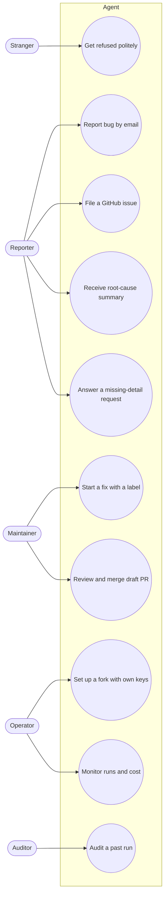
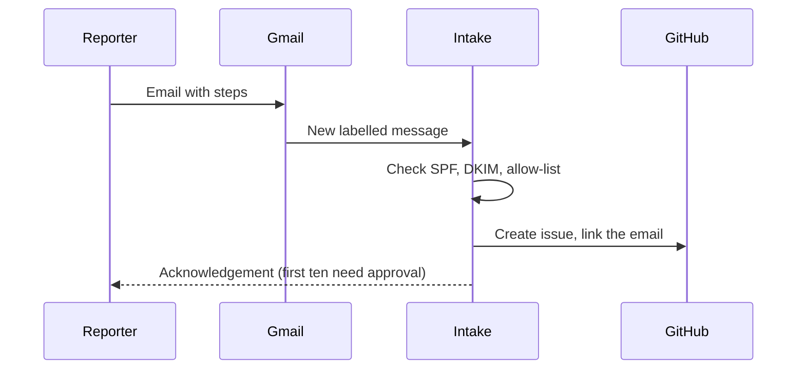
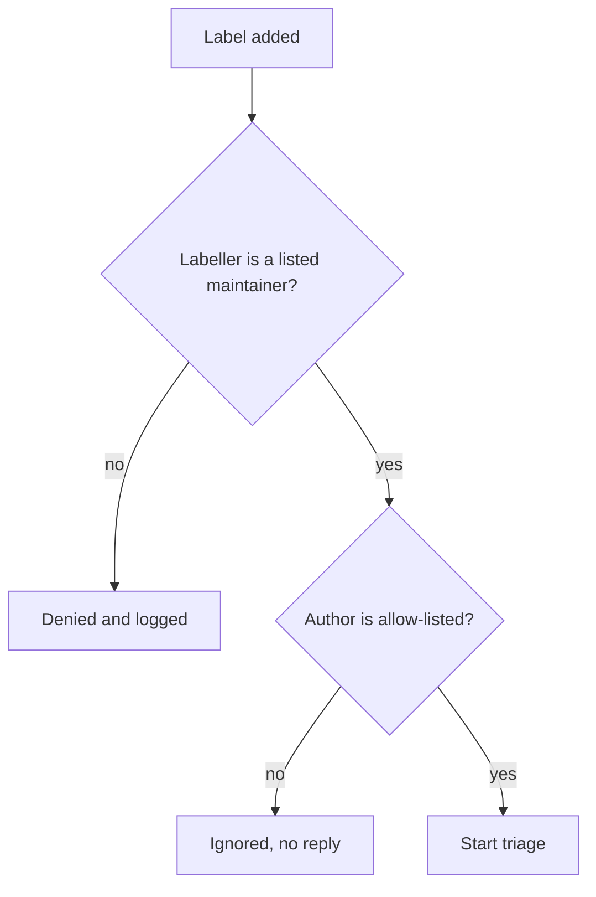

# Use Cases

**Audience:** everyone. **Status:** planned.

This document shows who uses the agent, what each person does with it, and what the system does in response.

## Actors

| Actor | Who they are | What they want |
|---|---|---|
| **Reporter** | An allow-listed person reporting a bug by email or as a GitHub issue author | A fix, and an explanation of what went wrong |
| **Stranger** | Anyone not on the allow-list | Nothing from the agent; a clear refusal by email |
| **Maintainer** | A listed maintainer of the repository | Draft fixes they can review, and control over every write |
| **Operator** | The person running a deployment, usually a fork owner | A working setup, known costs, and quick diagnosis |
| **Auditor** | Anyone checking a past run | Which decisions were made, by which rules, with which versions |

## Use case map

## UC1: Report a bug by email

**Actor:** Reporter. **Goal:** a bug becomes a tracked issue without the reporter needing GitHub.

## UC2: Get refused politely

**Actor:** Stranger. **Goal:** learn that the channel isn't open to them, without the agent acting on the message.

- An unauthenticated email is dropped with no reply.
- An authenticated email from a stranger gets one generic reply per day: "You are not permitted to raise issues through this channel."
- No issue is created in either case.

## UC3: File a GitHub issue

**Actor:** Reporter (allow-listed GitHub account). **Goal:** report a bug on the repository directly.

The issue is created as usual. The agent does nothing until a maintainer adds the `agent-fix` label. An issue from an author who isn't allow-listed stays open and the agent ignores it.

## UC4: Start a fix with a label

**Actor:** Maintainer. **Goal:** decide which issues the agent should work on.

## UC5: Review and merge the draft

**Actor:** Maintainer. **Goal:** decide whether the proposed fix goes in.

1. The agent pushes an `agent/issue-<number>` branch and opens a draft PR. Both need the maintainer's approval first.
2. The maintainer reads the PR, its root-cause description, and its test results.
3. The maintainer requests changes, closes the PR, or merges it.

The agent never merges.

## UC6: Receive a root-cause summary

**Actor:** Reporter. **Goal:** know what went wrong and why, in a form they can check.

The summary has five parts (what happened, root cause, why it happened, what changed, confidence and limits). Each claim cites a file, line, commit, or test. It reaches the reporter and the issue only after a maintainer approves it.

## UC7: Answer a missing-detail request

**Actor:** Reporter. **Goal:** provide the detail the agent needs to reproduce the bug.

When the agent can't reproduce a bug, it comments on the issue with what it tried and asks a specific question. The run waits for the answer, then continues or stops.

## UC8: Set up a fork with own keys

**Actor:** Operator. **Goal:** run the agent on their own repository, with their own credentials.

1. Fork the repository.
2. Create a GitHub App for the target repository, and a Gmail OAuth client for the intake address.
3. Set the Azure OpenAI endpoint, deployment, and key in the environment.
4. Write the allow-list for each channel.
5. Run the self-hosting guide's checks, including a test issue on a sandbox repository.

## UC9: Monitor runs and cost

**Actor:** Operator. **Goal:** see failures, slow steps, and cost before a reporter notices.

Dashboards show step latency and failure rates, approval waits, cost per issue, and reproduction and patch outcomes. Alerts fire on repeated failures, cost spikes, and any write without an approval record.

## UC10: Audit a past run

**Actor:** Auditor. **Goal:** confirm what the agent did and why.

Every run has a trace and an audit record. The auditor can see each trigger decision, each tool call, each approval, and the versions of the prompts, rules, and models used.

## Use cases not included

- Feature requests (see [FUTURE-SCOPE.md](FUTURE-SCOPE.md))
- Merging, closing, or re-labelling issues
- Replying to people outside the allow-list
- Changes to repositories the operator doesn't control

These are outside the agent's scope. See [BOUNDARIES.md](BOUNDARIES.md).
