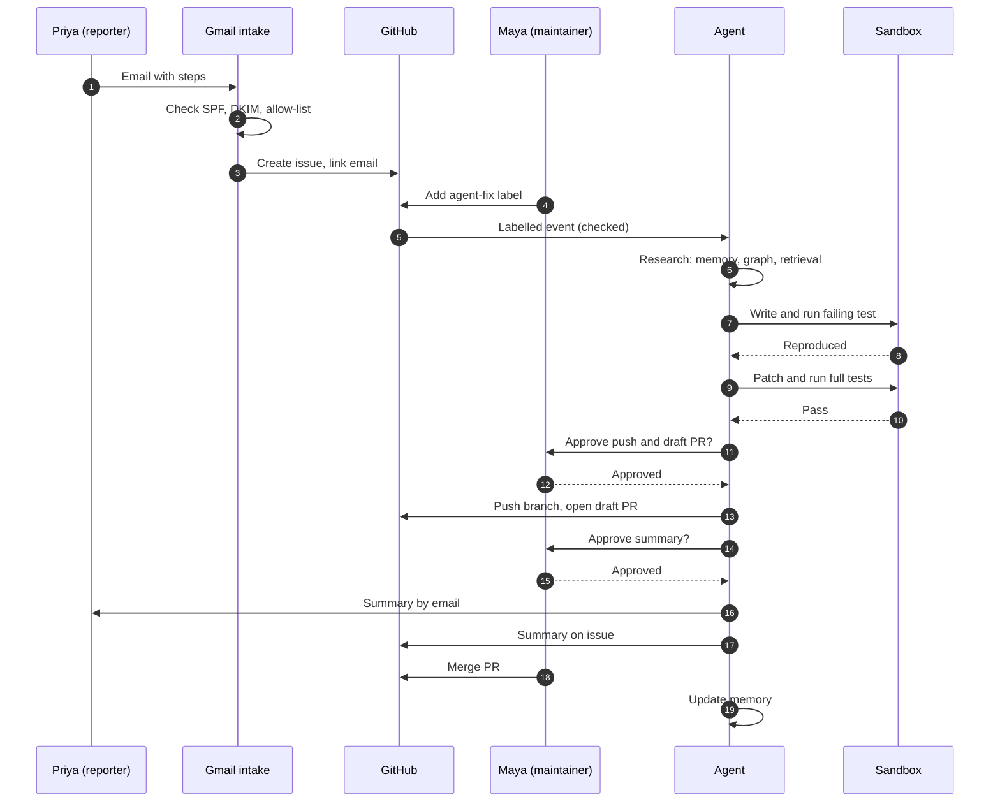

# Walkthrough

**Audience:** anyone new to the project. **Status:** planned behaviour, not yet built.

This walks through one realistic case from start to finish. The names and the bug are illustrative.

## The scenario

Priya uses the library in her product. After a password reset, users can't log in. She is on the allow-list for the project. She emails the project's reporting address with the steps she used.

Maya is the maintainer. She reviews agent work and decides what gets merged.

## Step 1: The report arrives

Priya sends an email to the reporting address.

- The Gmail intake reads new labelled messages.
- It checks the message's authentication results. SPF and DKIM both pass, and the DKIM signing domain matches Priya's domain.
- The sender is on the allow-list, so intake continues. Nothing is sent back to her yet.
- Intake extracts the title, steps, expected result, and actual result. If a required field is missing, it asks Priya for it rather than guessing.
- It checks for duplicates among open issues and memory of past fixes.
- It creates a GitHub issue and links it to Priya's email.
- It records every step in the audit log.

## Step 2: A maintainer decides to act

The issue exists, but nothing has changed in the code yet. Maya reads it and adds the `agent-fix` label.

- The trigger checks that Maya is a listed maintainer. Anyone else adding the label is denied, and that attempt is logged.
- It checks that the issue author is allow-listed.
- Only then does the agent start.

If Maya doesn't add the label, nothing happens. This is intentional: the agent doesn't act on every report.

## Step 3: The agent finds the code

The research step builds its picture of the problem.

- **Memory** shows that the password flow was changed in a past release, and that a similar bug was fixed in the session module.
- **The code graph** shows which files depend on the password-reset handler.
- **Retrieval** over code and docs returns the relevant functions, with file and line references.

The result is a short list of candidate files, each with its evidence.

## Step 4: The bug is reproduced

The reproduction step writes a failing test that follows Priya's steps. It runs the test in a sandbox with no network and no secrets.

- If the test fails the way Priya described, the bug is reproduced, and the agent continues.
- If it passes, or fails differently, the agent stops. It comments on the issue with what it tried and asks for more detail. It doesn't guess at a fix.

## Step 5: A patch is written and tested

The patch step edits the code on a branch called `agent/issue-<number>`.

- The agent makes a change, and the full test suite runs in the sandbox.
- The new test must pass, and no existing test may start failing.
- If the tests fail, the agent may try once more. After two attempts, it stops and escalates with its logs.

## Step 6: A draft PR is opened

If the tests pass, the agent asks the approval queue for permission to push. Maya approves.

The agent pushes the branch and opens a **draft** pull request. The description includes the root cause, the files changed, and the test results. Maya reviews it, the same way she would review a colleague's work.

The agent can't merge. Maya does, or she closes the PR.

## Step 7: The summary is prepared

When the PR is opened, the summary step writes a short explanation for Priya.

It has five parts:
- **What happened:** the behaviour Priya saw, in one sentence.
- **Root cause:** the mechanism, with file and line references.
- **Why it happened:** the change that introduced it, with the commit.
- **What changed:** the files and the new behaviour.
- **Confidence and limits:** what was tested, and what wasn't.

Every claim needs a citation. Any sentence without one is removed before the summary goes further.

Maya reviews the summary. She can edit it or approve it. Nothing is sent until she approves.

## Step 8: The summary goes out

After approval, the agent sends two things:

- A reply to Priya's email, in the same thread.
- A comment on the GitHub issue, linking the draft PR.

Both are labelled as AI-generated and reviewed by Maya.

## Step 9: The PR is merged, and memory is updated

When Maya merges the PR, the agent records what it learned:
- a `bug_fix` record linking the issue, PR, and commit
- a `root_cause` record, from the approved summary

The next report in the same module starts with that memory.

## What Priya sees

Priya's experience is short: she sends an email, and the next messages she gets are a reply from the project and, later, a note that the fix is merged.

```
Subject: Re: Password reset login bug

Hello Priya,

Thanks for the report. A maintainer has reviewed it and a draft fix is
open for review: <link to the draft PR>.

Root cause (AI-generated, reviewed by Maya):
The reset token was checked against the session store before it was
written, so valid tokens were rejected on the first attempt
(auth/reset.py, line 88; commit 3f2a9c1).

What changed: the write now happens before the check. The new test
test_reset_token_first_use passes, and the existing tests still pass.

Confidence: high for this path. Not tested: reset links opened in a
different browser.
```

The text above is an example of the format, not a real result.

## Cases where the agent stops

| Situation | What happens |
|---|---|
| Sender not on the allow-list | One generic reply per day; no issue is created |
| Email fails SPF or DKIM | Dropped with no reply |
| Automated sender (bounce, no-reply) | Dropped with no reply |
| Label added by someone who isn't a maintainer | Denied and logged; no work starts |
| Issue author not on the allow-list | Ignored; no reply |
| Bug can't be reproduced | Agent comments and asks for more detail; no patch |
| Two patch attempts fail | Escalates to a maintainer with the logs |
| Summary contains uncited claims | Those claims are removed before approval |

## The whole flow in one diagram


